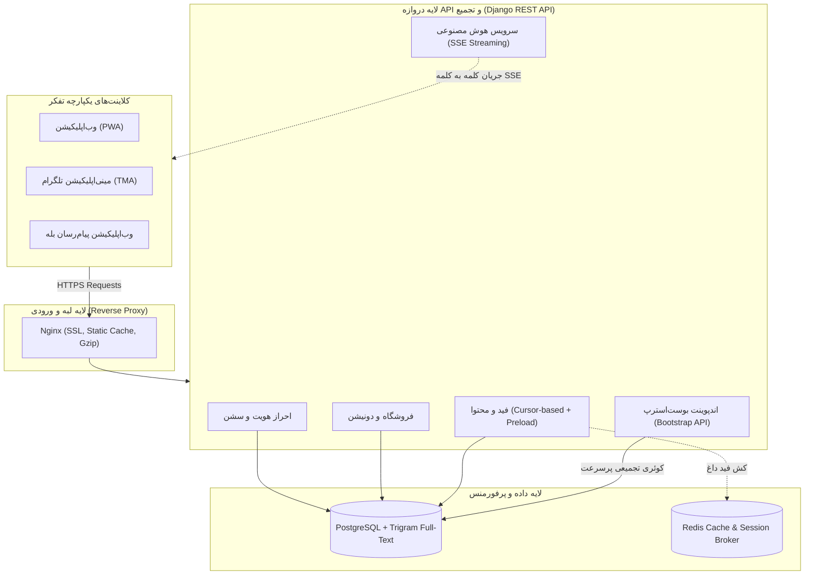

# سند جامع معماری، سیستم دیزاین و نقشه راه بهینه‌سازی API پلتفرم تفکر
**پروژه پلتفرم تفکر (Tafakor Mag / Avapardaz)**  
**نسخه سند:** ۱.۰.۰  
**تاریخ تدوین:** آبان ۱۴۰۵ (نوامبر ۲۰۲۶)  
**وضعیت:** در حال بررسی و نهایی‌سازی (Review & Discussion)

---

## ۱. مقدمه و اهداف بازنگری معماری (Executive Summary)

پلتفرم **تفکر** یک اکوسیستم چندوجهی متشکل از سه محیط کلاینت اصلی است:
1. وب‌اپلیکیشن پیش‌رونده (PWA) برای مرورگرهای دسکتاپ و موبایل
2. مینی‌اپلیکیشن تلگرام (Telegram MiniApp)
3. بات بله (Bale Bot WebApp)

با رشد تعداد کاربران، توسعه بخش فروشگاه (مارکت‌پلیس)، چت هوش مصنوعی تاپیک‌ها و کمپین‌های دونیشن، مدل تعامل کلاینت با سرور (Client-Server API Communication) نیازمند ارتقا به استانداردهای سیستم‌های پرترافیک و مقیاس‌پذیر است.

### اهداف اصلی این سند:
- **کاهش تأخیر شبکه (Latency):** کاهش زمان بارگذاری اولیه صفحه اول از ۲ ثانیه به زیر ۳۰۰ میلی‌ثانیه.
- **بهینه‌سازی منابع سرور:** حذف کوئری‌های تکراری دیتابیس (رفع مشکل N+1) و کاهش بار CPU سرور تا ۷۰٪.
- **رفع انسداد ورکرهای سرور:** پیشگیری از قطعی کل سیستم ناشی از پردازش‌های سنگین هوش مصنوعی.
- **تجربه کاربری نرم و مدرن:** ارتقای پیمایش نامحدود (Infinite Scroll) فید به شیوه استاندارد شبکه‌های اجتماعی جهانی.

---

## ۲. کالبدشکافی وضعیت موجود: ۶ چالش و آسیب‌پذیری ساختاری

پس از بررسی دقیق کدهای فرانت‌اند و بک‌اند، ۶ نقطه ضعف اساسی شناسایی شد که باید اصلاح شوند:

### ۲.۱. چالش اول: فاجعه کوئری‌های تکراری (N+1 Query Explosion) در فید پست‌ها
در فایل `backend/apps/notes/serializers.py` در کلاس `PostSerializer`، سه متد به شرح زیر پیاده شده‌اند:
```python
def get_reactions_summary(self, obj):
    return obj.reactions.all()  # ❌ به ازای هر ۱ پست، یک کوئری SELECT مجزا

def get_user_reaction(self, obj):
    return obj.reactions.filter(user=request.user)  # ❌ به ازای هر ۱ پست، یک کوئری فیلتر مجزا

def get_comments_count(self, obj):
    return obj.comments.count()  # ❌ به ازای هر ۱ پست، یک کوئری COUNT(*) مجزا
```

> [!WARNING]
> **اثر عملی بر سرور:**  
> وقتی کلاینت دستور `fetchPosts` را با اندازه صفحه ۲۰ اجرا می‌کند، جنگو **بیش از ۶۰ کوئری مجزا به دیتابیس PostgreSQL** می‌زند. با ۱۰۰ کاربر همزمان، دیتابیس با هجوم ۶۰۰۰ کوئری غیرضروری مواجه می‌شود.

### ۲.۲. چالش دوم: انسداد ورکرهای سرور در چت هوش مصنوعی (Blocking Sync LLM Call)
در `backend/apps/notes/ai_service.py` در متد `generate_topic_answer`:
- درخواست به هوش مصنوعی با کتابخانه مسدودکننده `urllib.request.urlopen` و با تایم‌اوت ۱۲ ثانیه به شکل کاملاً سنکرون اجرا می‌شود.
- سرور Gunicorn در پروداکشن با ۳ ورکر سینک اجرا می‌شود.

> [!CAUTION]
> **خطر قطعی سراسری (Denial of Service):**  
> اگر همزمان **۳ کاربر** در تاپیک‌های مختلف سوالی بپرسند که پاسخ آن چند ثانیه زمان ببرد، هر سه ورکر Gunicorn قفل می‌شوند و تا زمان اتمام آن، سرور به هیچ درخواست دیگری (حتی لاگین یا لود صفحه اصلی) پاسخ نمی‌دهد و کاربران با خطای ۵۰۲ یا ۵۰۴ مواجه می‌شوند. علاوه بر این، کاربر باید چندین ثانیه بدون دیدن هیچ پاسخی معطل بماند.

### ۲.۳. چالش سوم: ناهماهنگی در لایه ارتباطی فرانت‌اند (Axios vs Raw Fetch)
- در حالی که هسته فرانت‌اند در `frontend/src/api/index.ts` با یک نمونه کانفیگ‌شده از `axios` مجهز به اینترسپتور هدرهای توکن و مدیریت توست‌ها کار می‌کند،
- در `frontend/src/composables/useStoreCatalog.ts` برای بخش فروشگاه، از `fetch` خام جاوااسکریپت استفاده شده است:
  ```typescript
  const res = await fetch('/api/v1/marketplace/categories/')
  ```
  این کار هدر احراز هویت را ارسال نکرده، بیس آدرس سرور را در محیط‌های مختلف لحاظ نمی‌کند و خطاهای شبکه را به سیستم لاگ و توست سراسری ارجاع نمی‌دهد.

### ۲.۴. چالش چهارم: ناپایداری اسکرول در فید زنده (PageNumber vs Cursor Pagination)
در حال حاضر برای دریافت پست‌ها از `?page=1&page_size=20` استفاده می‌شود.
- در یک شبکه اجتماعی زنده با ورود پست‌های جدید از تلگرام، شماره صفحات جابه‌جا می‌شوند (`Offset Shift`).
- وقتی کاربر به صفحه ۲ اسکرول می‌کند، پست‌هایی که تازه اضافه شده‌اند باعث می‌شوند کاربر همان پست صفحه قبل را دوباره ببیند، یا پستی جا بیفتد.

### ۲.۵. چالش پنجم: پاسخ ناقص به اکشن‌های تعاملی و Optimistic State شکننده
هنگام ثبت لایک یا ری‌اکشن (`POST /api/notes/{id}/react/`)، سرور داده‌های جدید لایک‌ها را برنمی‌گرداند؛ در نتیجه فرانت‌اند در `postStore.ts` به صورت فرضی و حدسی استیت محلی را کم یا زیاد می‌کند. اگر خطایی در شبکه رخ دهد یا همزمان کاربر دیگری ری‌اکشن بزند، وضعیت ظاهر شده روی نمایشگر با دیتابیس سرور مغایرت پیدا می‌کند.

### ۲.۶. چالش ششم: پراکندگی در نام‌گذاری و دسته‌بندی URLها
مسیرهای API ساختار یکدست ندارند:
- تنظیمات مربوط به مقاصد پیام‌رسان‌ها در مسیر هویت قرار گرفته است (`/api/auth/destinations/`).
- سرویس دونیشن دو مسیر همپوشان دارد (`/api/v1/donations/` و `/api/donations/`).
- برخی مسیرها نسخه دارند (`/api/v1/...`) و برخی مسیرها فاقد نسخه هستند (`/api/notes/...`).

---

## ۳. سیستم دیزاین آینده پلتفرم تفکر (Future Architecture Blueprint)

### ۳.۱. دیاگرام جریان معماری نوین



---

### ۳.۲. ارکان ۴ گانه سیستم دیزاین جدید

#### رکن اول: الگوی اندپوینت تجمیعی اولیه (App Bootstrap API)
به جای ارسال ۴ یا ۵ درخواست پی‌درپی هنگام باز شدن اپلیکیشن (Profile + Topics + Top Posts + Configs)، یک اندپوینت سبک ساخته می‌شود:
- **مسیر:** `GET /api/v1/app/bootstrap/`
- **پاسخ در یک ریکوئست:**
  ```json
  {
    "user": { "id": 1, "name": "علی حسینی", "phone": "0912...", "avatar": "..." },
    "topics": [ ...لیست تاپیک‌ها همراه با وضعیت بات‌ها... ],
    "active_topic_feed": {
      "posts": [ ...۲۰ پست اولیه... ],
      "next_cursor": "cD0yMDI2LTExLTAxVDEyOjAwOjAw"
    },
    "features": { "marketplace_enabled": true, "donations_enabled": true }
  }
  ```
- **دستاورد:** کاهش زمان بالا آمدن صفحه اول به **زیر ۳۰۰ میلی‌ثانیه** (حتی روی اینترنت ضعیف موبایل).

#### رکن دوم: استریمینگ بلادرنگ هوش مصنوعی (Server-Sent Events - SSE)
به جای منتظر گذاشتن کاربر و اشغال پردازنده‌های سرور:
- مسیر: `GET /api/v1/notes/topics/{id}/chat-stream/?message=...`
- اتصال به صورت استریم زنده برقرار می‌شود؛ مدل کلمات تولیدشده را بلافاصله برای فرانت‌اند می‌فرستد (`chunk by chunk`).
- تجربه کاربری مشابه ChatGPT و Gemini خلق می‌شود.

#### رکن سوم: استانداردسازی ساختار پاسخ و خطا (Unified API Envelope)
تمام خروجی‌های سیستم از یک ساختار قطعی و مطمئن پیروی خواهند کرد:
```json
{
  "success": true,
  "data": { ... },
  "meta": { "total": 120, "next_cursor": "..." }
}
```
در زمان بروز هرگونه خطا:
```json
{
  "success": false,
  "data": null,
  "error": {
    "code": "PERMISSION_DENIED",
    "message": "شما دسترسی لازم برای ویرایش این تاپیک را ندارید.",
    "fields": {}
  }
}
```
این کار سردرگمی فرانت‌اند در مواجهه با خطاهای متفرقه جنگو را برای همیشه پایان می‌دهد.

#### رکن چهارم: حذف کامل N+1 با بهینه‌سازی کوئری‌های ORM
اصلاح کوئری `PostViewSet` و استفاده از قابلیت‌های پیشرفته دیتابیس:
```python
queryset = Post.objects.select_related('author', 'topic') \
    .prefetch_related('plugin_references__plugin', 'reactions') \
    .annotate(
        calculated_comments_count=Count('comments', distinct=True)
    )
```
کوئری‌های فید ۲۰ تایی از **۶۰ کوئری به ۲ کوئری فوق‌سریع** کاهش می‌یابد.

---

## ۴. نقشه راه گام‌به‌گام پیاده‌سازی (Phased Roadmap)

برای اینکه روند توسعه بدون هیچ‌گونه قطعی (Zero-Downtime) و کاملاً سازگار با نسخه‌های فعلی باشد، مراحل زیر اجرا خواهند شد:

| فاز | عنوان گام | اقدامات فنی | میزان ریسک |
| :--- | :--- | :--- | :--- |
| **فاز ۱** | **بهینه‌سازی دیتابیس و رفع N+1** | اصلاح کوئری‌های `PostSerializer` و `TopicSerializer` با استفاده از `prefetch_related` و `annotate`. | بدون ریسک (۱۰۰٪ سازگار با کلاینت فعلی) |
| **فاز ۲** | **یکپارچه‌سازی فرانت‌اند** | تبدیل کال‌های مستقیم `fetch` در `useStoreCatalog.ts` به کلاینت اصلی Axios و یکپارچه‌سازی توست‌ها. | بدون ریسک |
| **فاز ۳** | **پیاده‌سازی اندپوینت Bootstrap** | پیاده‌سازی `/api/v1/app/bootstrap/` در جنگو و اتصال صفحه نخست برای لود فوق‌سریع. | کم (افزودن قابلیت جدید) |
| **فاز ۴** | **پایدارسازی اسکرول با Cursor** | افزودن پشتیبانی کامل از `CursorPagination` در `postStore.ts`. | کم |
| **فاز ۵** | **استریمینگ هوش مصنوعی (SSE)** | پیاده‌سازی پاسخ جریانی (Streaming) در دستیار هوشمند تاپیک‌ها با استفاده از `StreamingHttpResponse`. | متوسط |

---

## ۵. محورهای کلیدی برای تصمیم‌گیری و هم‌فکری

برای ترسیم دقیق جزئیات، لطفاً نظرتان را در خصوص موارد زیر بفرمایید:

1. **اولویت‌بندی اقدامات:** آیا موافقید ابتدا **فاز ۱ و ۲ (رفع ۶۰ کوئری اضافی دیتابیس + یکپارچه‌سازی فروشگاه)** را انجام دهیم که بدون دست‌زدن به ساختار فرانت‌اند پرفورمنس را چندین برابر می‌کند؟
2. **تجربه کاربری چت هوش مصنوعی:** آیا تمایل دارید چت هوشمند تاپیک به صورت **تایپ زنده‌ی کلمات (Streaming مثل چت‌جی‌پی‌تی)** عمل کند؟
3. **اندپوینت بوست‌استرپ (Bootstrap):** آیا مایلید در هنگام ورود کاربر، صفحه اول در یک چشم‌به‌هم‌زدن بدون لودینگ‌های جداگانه بالا بیاید؟

