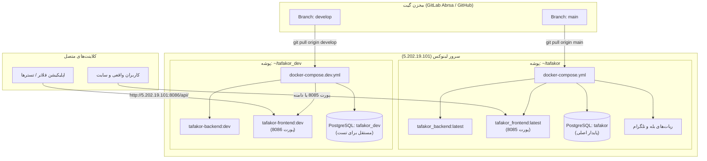

# 📘 راهنمای جامع معماری چندمحیطه (Production vs Development)، تفکیک ایمیج‌ها و زیرساخت اشتراک‌ها
**پروژه پلتفرم تفکر (Tafakor Mag / Avapardaz)**  
**نسخه سند:** ۱.۰.۰  
**تاریخ نگارش:** آبان ۱۴۰۵ (نوامبر ۲۰۲۶)  
**تهیه‌کننده:** تیم DevOps / SRE تفکر  

---

## ۱. فلسفه و اهداف معماری ایزوله (Zero Blast-Radius)

هدف از این معماری، فراهم کردن یک محیط توسعه و تست زنده (**Development / Staging**) روی همان سرور اصلی پروداکشن است؛ به طوری که:
1. **ریسک صفر برای پروداکشن (Zero Blast-Radius):** دیتابیس، ولوم‌ها، کانتینرها و شبکه‌های دو محیط کاملاً تفکیک شده و هیچ تداخلی با هم ندارند.
2. **مدیریت ۱۰۰٪ با گیت (Pure GitOps):** هیچ فایل یا کانتینری به صورت دستی و بدون ردیابی در گیت روی سرور ایجاد نمی‌شود.
3. **تفکیک ایمیج‌های داکر (Image Tagging Strategy):** ایمیج‌های دو محیط تگ‌های مستقل دارند و کش آن‌ها یکدیگر را بازنویسی نمی‌کند.
4. **سیاست خاموشی ربات‌ها (Dead Bots Policy):** سرویس‌های ربات تلگرام و بله در دِو غیرفعال هستند تا خطای تداخل توکن (Error 409 Conflict) با ربات‌های زنده پروداکشن رخ ندهد.

---

## ۲. ماتریس مقایسه پروداکشن و دولوپ روی سرور

| ویژگی / مولفه | 🟢 محیط پروداکشن (Production) | 🟡 محیط دولوپ (Development) |
| :--- | :--- | :--- |
| **مسیر روی سرور** | `/home/testaminadhami/tafakor` | `/home/testaminadhami/tafakor_dev` |
| **برنچ متناظر در گیت** | `main` | `develop` |
| **فایل کامپوز اجراکننده** | `docker-compose.yml` | `docker-compose.dev.yml` |
| **تگ ایمیج بک‌اند** | `tafakor-backend:latest` | `tafakor-backend:dev` |
| **تگ ایمیج فرانت‌اند** | `tafakor-frontend:latest` | `tafakor-frontend:dev` |
| **پورت دسترسی بیرونی** | **`8085`** (`https://tafakormag.ir`) | **`8086`** (`http://5.202.19.101:8086`) |
| **دیتابیس PostgreSQL** | دیتابیس اصلی `tafakor` (ولوم `postgres_data`) | دیتابیس مجزا `tafakor_dev` (ولوم `dev_postgres_data`) |
| **نام پروژه داکر (`-p`)** | `tafakor` یا `tafakor_prod` | `tafakor_dev` |
| **نام کانتینرها** | `tafakor_backend`, `tafakor_db`, ... | `tafakor_dev_backend`, `tafakor_dev_db`, ... |
| **وضعیت ربات‌ها** | فعال و متصل به تلگرام و بله | کاملاً غیرفعال (جلوگیری از ارور 409) |
| **حالت دیباگ (`DEBUG`)** | `False` | `True` |
| **سَندباکس پرداخت کافه‌بازار** | `False` (درگاه و توکن واقعی) | `True` (پذیرش توکن‌های تستی) |

---

## ۳. دیاگرام جریان کاری و معماری ارتباطات



---

## ۴. چرخه گام‌به‌گام کاری (Day-to-Day DevOps Workflow)

### گام اول: کدنویسی و تست روی برنچ دولوپ
1. روی سیستم لوکال تغییرات را روی برنچ `develop` ایجاد و تست کنید:
   ```bash
   git checkout develop
   git add .
   git commit -m "feat: new feature description"
   git push origin develop
   ```

### گام دوم: استقرار روی سرور دولوپ (پورت ۸۰۸۶)
2. وارد سرور و پوشه دِو شوید و کدها را دریافت و بیلد کنید:
   ```bash
   cd ~/tafakor_dev
   git pull origin develop
   docker compose -p tafakor_dev -f docker-compose.dev.yml up -d --build
   ```
3. اعتبارسنجی کانتینرها:
   ```bash
   docker ps
   ```

### گام سوم: تست با اپلیکیشن موبایل (Flutter)
در فایل `lib/common/constants/app_constants.dart` آدرس را به سرور دِو هدایت کنید:
```dart
static const String tafakorBaseUrl = 'http://5.202.19.101:8086/api/';
```
*(به دلیل وجود `android:usesCleartextTraffic="true"` در `AndroidManifest.xml`، ارتباط بدون خطا برقرار می‌شود).*

### گام چهارم: ارتقا به پروداکشن پس از تایید نهایی (Promotion)
پس از تایید تست‌ها در محیط دِو:
1. برنچ `develop` را به `main` مرج کنید:
   ```bash
   git checkout main
   git merge develop
   git push origin main
   ```
2. روی سرور وارد پوشه پروداکشن شوید و بدون قطعی، بک‌اند را نوسازی کنید:
   ```bash
   cd ~/tafakor
   git pull origin main
   docker compose up -d --no-deps --build backend
   ```

---

## ۵. دستورالعمل کپی دیتای پروداکشن به دولوپ (Data Seeding)

اگر برای تست نیاز دارید دیتابیس دِو حاوی داده‌های واقعی پروداکشن باشد (بدون اینکه به پروداکشن آسیبی برسد):

```bash
# ۱. گرفتن خروجی از دیتابیس پروداکشن
docker exec -t tafakor_db pg_dump -U postgres tafakor > /tmp/prod_dump.sql

# ۲. تزریق خروجی به دیتابیس دولوپ
docker exec -i tafakor_dev_db psql -U postgres -d tafakor_dev < /tmp/prod_dump.sql

# ۳. پاکسازی فایل موقت
rm /tmp/prod_dump.sql
```

---

## ۶. پیوست: تنظیمات وب‌سرویس کافه‌بازار (In-App Purchases)

برای اتصال به سرور اعتبارسنجی کافه‌بازار و وریفای توکن‌های خرید Poolakey:

### متغیرهای محیطی در فایل `.env`:
```env
BAZAAR_SANDBOX=false                      # برای محیط تست true و برای پروداکشن false
BAZAAR_PACKAGE_NAME=com.tafakor.quran     # شناسه بسته اندروید
BAZAAR_CLIENT_ID=کلید_کلاینت              # از پیشخان کافه‌بازار > تنظیمات > API
BAZAAR_CLIENT_SECRET=رمز_کلاینت
BAZAAR_REFRESH_TOKEN=رفرش_توکن_دائمی      # حاصل تبادل authorization_code با بازار
```

### فرآیند دریافت Refresh Token از بازار:
1. دریافت `client_id` و `client_secret` از پیشخان بازار.
2. دریافت کد تایید با باز کردن آدرس زیر در مرورگر:
   ```text
   https://pardakht.cafebazaar.ir/devapi/v2/auth/authorize/?response_type=code&access_type=offline&client_id=YOUR_CLIENT_ID&redirect_uri=https://localhost:8000/
   ```
3. تبادل کد و دریافت توکن نهایی:
   ```bash
   curl -X POST https://pardakht.cafebazaar.ir/devapi/v2/auth/token/ \
     -d "grant_type=authorization_code" \
     -d "client_id=YOUR_CLIENT_ID" \
     -d "client_secret=YOUR_CLIENT_SECRET" \
     -d "code=CODE_OBTAINED_FROM_STEP_2" \
     -d "redirect_uri=https://localhost:8000/"
   ```

---

## ۷. فرمان‌های عیب‌یابی سریع (Cheat Sheet)

```bash
# مشاهده وضعیت تمام کانتینرهای فعال سرور
docker ps --format "table {{.Names}}\t{{.Status}}\t{{.Ports}}"

# لاگ زنده بک‌اند دولوپ
docker logs -f --tail 100 tafakor_dev_backend

# لاگ زنده بک‌اند پروداکشن
docker logs -f --tail 100 tafakor_backend

# ریستارت بدون قطعی پروداکشن
docker restart tafakor_backend

# اجرای دستورات مدیریت جنگو در دولوپ (مثلاً پلن‌های اشتراک)
docker exec -t tafakor_dev_backend python manage.py seed_subscription_plans
```
