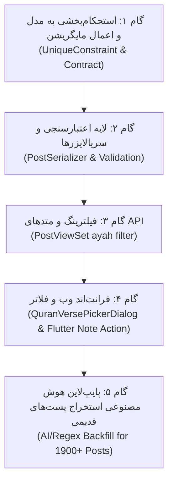

# سند معماری و نقشه راه فنی اتصال پست‌ها به افزونه‌ها (Plugin Architecture & Roadmap)

**وضعیت سند:** تصویب‌شده / آماده ورود به فاز توسعه  
**تاریخ ایجاد:** ۱۴۰۵/۰۸/۰۷ (2026-10-29)  
**پروژه:** پلتفرم تفکر (Tafakor Mag / Avapardaz)  

---

## ۱. تحلیل معماری فعلی (Current Architectural Review)

در حال حاضر، سیستم به شکل **۳ لایه کاملاً مجزا (Loose Coupling)** پیاده‌سازی شده است:

```
┌─────────────────────────────────┐       ┌───────────────────────────────────────┐
│     Core Domain: notes.Post     │       │       Plugin Domain: Quran Data       │
│─────────────────────────────────│       │───────────────────────────────────────│
│ - id (BigInt/UUID)              │       │ - QuranSurah (1 to 114)               │
│ - content (Text)                │       │ - QuranAyah (1 to 6236)               │
│ - author, topic, created_at     │       │ - QuranEdition (Translations, Audio)  │
└────────────────┬────────────────┘       └───────────────────▲───────────────────┘
                 │                                            │
                 │              ┌──────────────────────────┐  │ (Loose Semantic Link)
                 └─────────────►│   PostPluginReference    ├──┘
                                │──────────────────────────│
                                │ - post_id (FK to Post)   │
                                │ - plugin_id ('quran')    │
                                │ - resource_type ('ayah') │
                                │ - external_id ('surah:X')│
                                │ - metadata (JSONField)   │
                                └──────────────────────────┘
```

### نقاط قوت معماری (Design Strengths):
1. **انعطاف‌پذیری و مقیاس‌پذیری (Scalability):** به جدول مرکزی `Post` هیچ فیلد اختصاصی قرآن اضافه نشده است. در آینده برای پلاگین‌های جدید (مانند گنجور، احادیث، لغت‌نامه) هیچ تغییری در جداول اصلی نیاز نیست.
2. **استقلال کلاینت آفلاین (Flutter Compatibility):** استفاده از شناسه استاندارد متنی (Canonical Key) باعث شده وابستگی به شناسه داخلی دیتابیس لوکال موبایل یا PostgreSQL حذف شود.

---

## ۲. هشدارهای فنی و باگ‌های بالقوه (Senior Warnings & Red Flags)

این موارد باید قبل یا در حین توسعه برطرف شوند تا از بروز دیتای کثیف و افت پرفورمنس جلوگیری شود:

### ⚠️ اخطار ۱: نبود Constraint یکتایی در جدول واسط (Duplicate References)
* **مشکل:** در مدل [`PostPluginReference`](file:///d:/django/tafakormag_avapardaz/backend/apps/plugin_system/models.py#L141-L171) تنها چند Index ساده تعریف شده و هیچ قید یکتایی وجود ندارد.
* **ریسک:** در صورت ویرایش مکرر پست یا ارسال همزمان درخواست توسط کاربر، ممکن است یک آیه چندین بار برای یک پست رفرنس بخورد.
* **راهکار:** اضافه شدن `UniqueConstraint(fields=['post', 'plugin', 'resource_type', 'external_id'])`.

### ⚠️ اخطار ۲: نبود اعتبارسنجی ارجاع در دیتابیس (Lack of Referential Integrity)
* **مشکل:** فیلد `external_id` متنی است و دیتابیس بررسی نمی‌کند که آیا چنین منبعی در سیستم وجود خارجی دارد یا خیر.
* **ریسک:** ذخیره مقادیر نامعتبر یا ساختگی (مانند `surah:999,ayah:888`).
* **راهکار:** پیاده‌سازی سیستم اعتبارسنجی (Validator) در لایه بیزینس‌لاژیک یا Serializer قبل از `save`.

### ⚠️ اخطار ۳: چالش کوئری‌های N+1 و افت پرفورمنس
* **مشکل:** در فید پست‌ها، برای لود متن آیه نمی‌توان از `select_related` ساده جنگو استفاده کرد.
* **راهکار:** تکنیک **Denormalization سبک**؛ ذخیره کردن متن کوتاه، نام سوره و شماره در فیلد `metadata` همان جدول رفرنس، تا فید پست‌ها نیازی به کوئری جداگانه به جدول آیات نداشته باشد.

### ⚠️ اخطار ۴: قرارداد استاندارد رشته‌های شناسه (Canonical Format Contract)
* **قرارداد قطعی:** فرمت استاندارد برای آیه‌ها **`surah:{number},ayah:{number}`** تعیین می‌شود (مثال: `surah:2,ayah:255`). تمام کلاینت‌ها (وب، فلاتر، اسکریپت‌های هوش مصنوعی) باید منحصراً از این فرمت تبعیت کنند.

---

## ۳. نقشه راه گام‌به‌گام توسعه (Step-by-Step Roadmap)



### گام ۱: استحکام‌بخشی به مدل (Model Hardening) ✅ [تکمیل شد]
1. ویرایش مدل `PostPluginReference` در `apps/plugin_system/models.py`.
2. افزودن `models.UniqueConstraint(fields=['post', 'plugin', 'resource_type', 'external_id'], name='unique_post_plugin_resource')`.
3. ایجاد و اجرای مایگریشن جنگو (`0002_postpluginreference_unique_post_plugin_resource`).

### گام ۲: سریالایزر و اعتبارسنجی ورودی (Serializers & Validation) ✅ [تکمیل شد]
1. افزودن `PluginReferenceValidator` در `apps/plugin_system/validator.py` جهت نرمال‌سازی خودکار و ولیدیشن محدوده سوره‌ها و آیات.
2. پیاده‌سازی `PostPluginReferenceSerializer` و اتصال Nested (خواندنی و نوشتنی) در `PostSerializer`.
3. تست و تأیید ثبت خودکار متادیتا و جلوگیری از ثبت آیه‌های نامعتبر (مانند سوره ۹۹۹).

### گام ۳: فیلترینگ و کوئری‌های کارآمد (API Optimization) ✅ [تکمیل شد]
1. پیاده‌سازی فیلتر اختصاصی در `PostViewSet.get_queryset()`:
   - پارامتر `?ayah=2:255` یا `?ayah=surah:2,ayah:255`
   - پارامتر `?external_id=...` و `?plugin=quran`
2. بهینه‌سازی خواندن با `prefetch_related('plugin_references__plugin')` برای رفع کامل مشکل N+1.
3. تست و راستی‌آزمایی موفق از طریق تست HTTP واقعی.

### گام ۴: اتصال سمت کلاینت (Frontend & Flutter) ⏳ [گام پیش‌رو]
1. اتصال کامپوننت انتخاب آیه (`QuranVersePickerDialog.vue`) در نوار ورودی ایجاد پست وب (`TopicMessageInput.vue`).
2. نمایش تگ نشانگر آیه قرآنی روی کارت‌های پست (`TopicPostCard.vue` یا `PostCard.vue`).
3. اتصال اکشن افزودن یادداشت به آیه در ریدر قرآن فلاتر (`quran_reader_screen.dart`).

### گام ۵: استخراج هوشمند و بک‌فیل تاریخچه (AI Historical Backfill)
1. اجرای اسکریپت پایپ‌لاین دو مرحله‌ای (Regex + LLM) بر روی پست‌های گذشته مطابق سند [QURAN_POST_AI_BACKFILL_PLAN.md](file:///d:/django/tafakormag_avapardaz/docs/QURAN_POST_AI_BACKFILL_PLAN.md).
2. تزریق رفرنس‌ها پس از بازبینی Dry-Run.

---

## ۴. وضعیت فعلی و گام پیش‌رو
- **فاز بکند (مراحل ۱، ۲ و ۳):** به صورت کامل، استاندارد و با تست‌های موفق در سرور پیاده‌سازی شد.
- **آماده ورود به گام ۴:** اتصال رابط کاربری وب و فلاتر برای انتخاب و نمایش آیات زیر پست‌ها.

