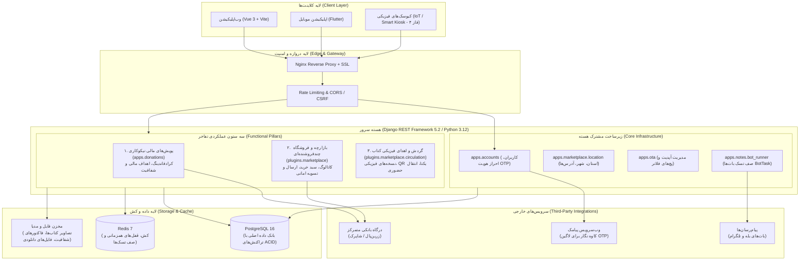
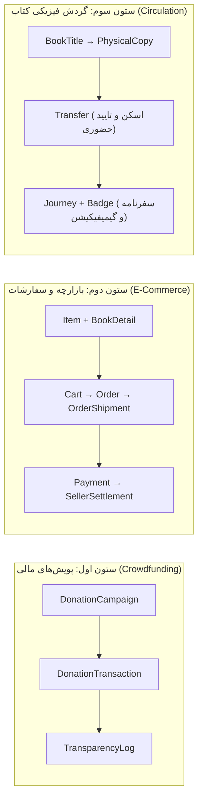
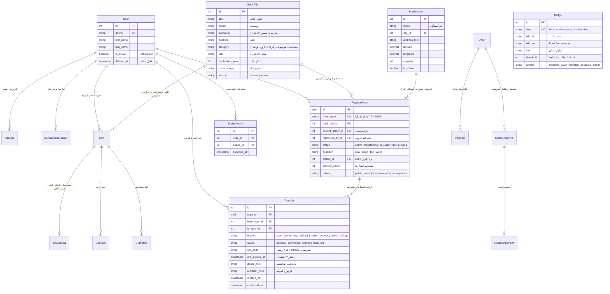
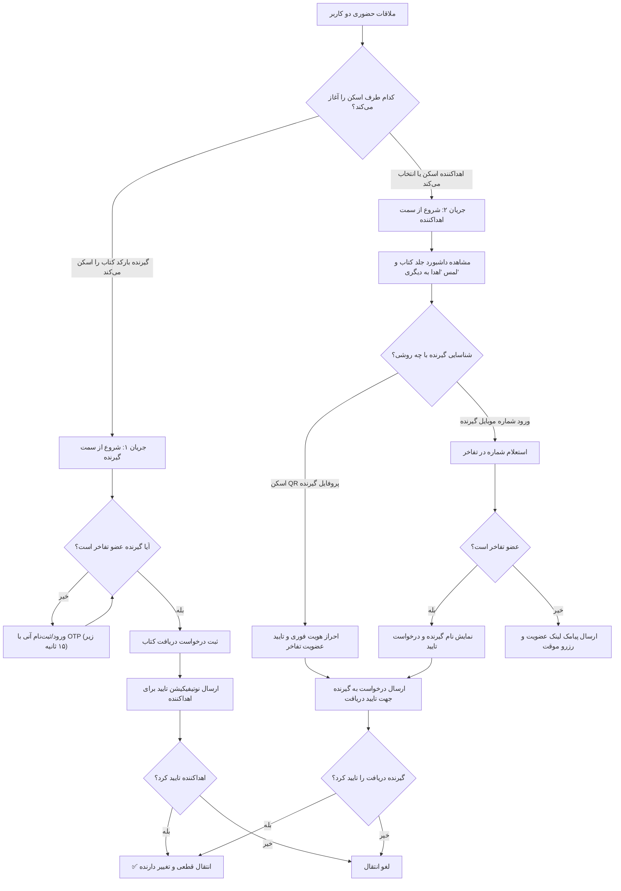
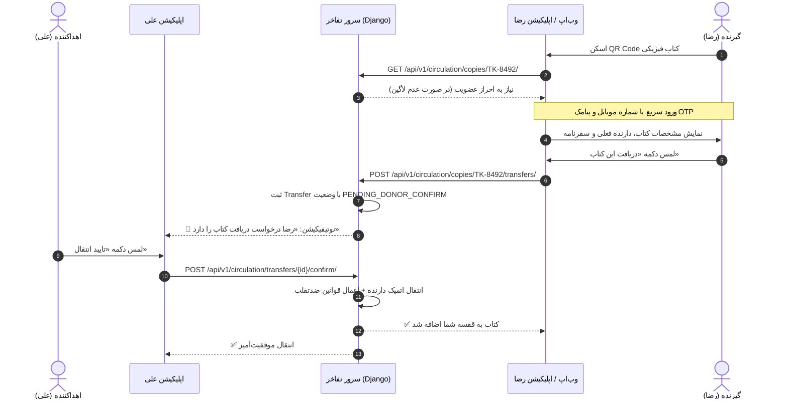
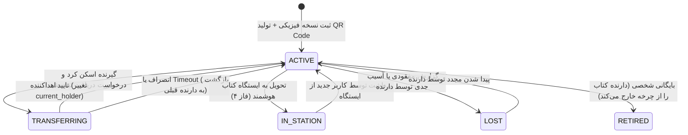
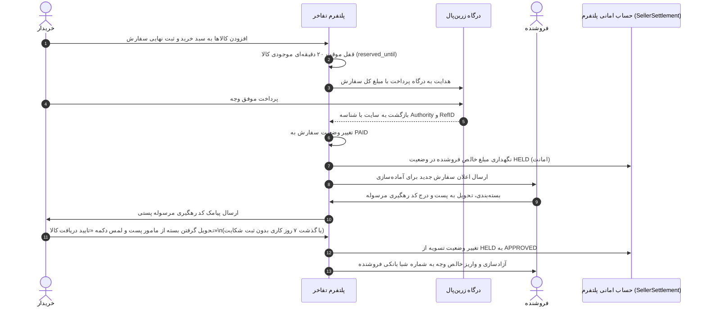

# 🏛️ سند جامع سیستم دیزاین و معماری یکپارچه پلتفرم تفاخر
> **Tafakor Platform — Master System Design, Unified Architecture & Domain Blueprints**  
> *نسخه: ۲.۱.۰ | تاریخ: ۹ نوامبر ۲۰۲۶ | وضعیت: مصوب و نقشه راه توسعه*

---

## ۰. قراردادهای نام‌گذاری (Naming Conventions)

### ۰.۱. نام‌گذاری ماژول‌ها و پلاگین‌ها
| مفهوم | نام ماژول | مسیر | توضیح |
|:---|:---|:---|:---|
| احراز هویت و کاربران | `accounts` | `backend/apps/accounts/` | لاگین OTP، پروفایل، Soft Delete |
| تاپیک‌ها و پست‌ها | `notes` | `backend/apps/notes/` | هسته اصلی محتوا و گفتگو |
| پویش‌های مالی نیکوکاری | `donations` | `backend/apps/donations/` | کرادفاندینگ، تراکنش‌های بانکی، شفافیت مالی |
| بازارچه و فروشگاه | `marketplace` | `backend/plugins/marketplace/` | کاتالوگ، سبد خرید، سفارشات، تسویه امانی |
| گردش و اهدای فیزیکی کتاب | `circulation` | `backend/plugins/circulation/` | **پلاگین مستقل** — نسخه‌های فیزیکی، QR، انتقال حضوری |
| آپدیت اپلیکیشن فلاتر | `ota` | `backend/apps/ota/` | Flutter Patcher، مدیریت نسخه‌ها |
| سیستم پلاگین‌ها | `plugin_system` | `backend/apps/plugin_system/` | رجیستری و مدیریت افزونه‌ها |
| اشتراک و VIP | `subscriptions` | `backend/apps/subscriptions/` | خریدهای درون‌برنامه‌ای، Cafe Bazaar |

### ۰.۲. نام‌گذاری مدل‌ها (Models)
| مدل | نام انگلیسی | جدول دیتابیس (`db_table`) | شرح |
|:---|:---|:---|:---|
| عنوان مرجع کتاب | `BookTitle` | `circulation_book_titles` | اطلاعات کاتالوگی: عنوان، نویسنده، ناشر، شابک |
| نسخه فیزیکی کتاب | `PhysicalCopy` | `circulation_physical_copies` | هر جلد کتاب با QR Code یکتا |
| رکورد انتقال | `Transfer` | `circulation_transfers` | هر دفعه دست‌به‌دست شدن (سفرنامه کتاب) |
| ایستگاه کتاب (فاز ۴) | `BookStation` | `circulation_book_stations` | کیوسک‌ها و دستگاه‌های فیزیکی هوشمند |
| نشان افتخار | `Badge` | `circulation_badges` | نشان‌های گیمیفیکیشن (سفیر کتاب و...) |
| اعطای نشان | `BadgeAward` | `circulation_badge_awards` | ثبت اعطای نشان به کاربر |

### ۰.۳. نام‌گذاری اندپوینت‌های API (RESTful Naming)
| عملیات | HTTP Method | Endpoint | توضیح |
|:---|:---|:---|:---|
| لیست نسخه‌های فیزیکی من | `GET` | `/api/v1/circulation/copies/` | قفسه شخصی کتاب‌های کاربر |
| ثبت نسخه فیزیکی جدید | `POST` | `/api/v1/circulation/copies/` | ثبت کتاب جدید و تولید QR Code |
| بررسی بارکد (اسکن) | `GET` | `/api/v1/circulation/copies/{short_code}/` | تشخیص نقش اسکن‌کننده و نمایش اطلاعات متناسب |
| شروع فرآیند انتقال | `POST` | `/api/v1/circulation/copies/{short_code}/transfers/` | اهداکننده شروع انتقال حضوری را ثبت می‌کند |
| تایید دریافت توسط گیرنده | `POST` | `/api/v1/circulation/transfers/{id}/confirm/` | گیرنده انتقال را با کد تایید یا تایید مستقیم نهایی می‌کند |
| سفرنامه یک جلد کتاب | `GET` | `/api/v1/circulation/copies/{short_code}/journey/` | تاریخچه دست‌به‌دست شدن و یادداشت‌ها |
| ثبت یادداشت خاطره | `POST` | `/api/v1/circulation/copies/{short_code}/notes/` | ثبت نظر و بازخورد روی این جلد |
| جستجوی عنوان کتاب | `GET` | `/api/v1/circulation/titles/` | جستجو بر اساس نام، نویسنده یا شابک |
| جستجو با شابک (ISBN) | `GET` | `/api/v1/circulation/titles/lookup/?isbn={isbn}` | پر شدن خودکار مشخصات با اسکن بارکد پشت جلد |
| لیست ایستگاه‌ها (فاز ۴) | `GET` | `/api/v1/circulation/stations/` | فهرست کیوسک‌ها با فیلتر شهر و موقعیت |
| لیست نشان‌های من | `GET` | `/api/v1/circulation/badges/` | نشان‌های کسب‌شده کاربر |

### ۰.۴. نام‌گذاری فایل‌های بک‌اند (Django Files)
```
backend/plugins/circulation/
├── __init__.py
├── apps.py                    # CirculationConfig
├── plugin.py                  # ثبت در سیستم پلاگین تفاخر
├── manifest.json
├── models/
│   ├── __init__.py
│   ├── title.py               # BookTitle
│   ├── copy.py                # PhysicalCopy
│   ├── transfer.py            # Transfer
│   ├── station.py             # BookStation (فاز ۴)
│   └── badge.py               # Badge, BadgeAward
├── serializers/
│   ├── __init__.py
│   ├── title.py
│   ├── copy.py
│   ├── transfer.py
│   └── journey.py             # سریالایزر سفرنامه و تایم‌لاین
├── services/
│   ├── __init__.py
│   ├── copy_service.py        # ثبت نسخه، تولید short_code و QR
│   ├── transfer_service.py    # منطق انتقال حضوری و OTP/Push
│   ├── isbn_service.py        # جستجوی خودکار مشخصات با شابک
│   └── badge_service.py       # محاسبه و اعطای نشان‌ها
├── views/
│   ├── __init__.py
│   ├── copy_views.py
│   ├── transfer_views.py
│   ├── title_views.py
│   └── badge_views.py
├── urls.py
├── permissions.py
├── exceptions.py
├── admin.py
├── migrations/
└── tests/
```

### ۰.۵. نام‌گذاری کامپوننت‌های فرانت‌اند (Vue / Flutter)
| کامپوننت | نام فایل | شرح |
|:---|:---|:---|
| اسکنر QR دوربین | `QrScannerView` | صفحه باز شدن دوربین و اسکن بارکد |
| صفحه نتیجه اسکن (مالک) | `CopyOwnerView` | نمایش گزینه‌های مدیریت برای دارنده فعلی |
| صفحه نتیجه اسکن (گیرنده) | `CopyClaimView` | فرم دریافت کتاب و وارد کردن کد تایید |
| سفرنامه کتاب | `CopyJourneyTimeline` | خط زمانی سفرنامه و یادداشت‌های خوانندگان |
| قفسه شخصی کتاب‌ها | `MyLibraryView` | لیست کتاب‌هایی که هم‌اکنون نزد کاربر است |
| فرم ثبت کتاب جدید | `RegisterCopyDialog` | فرم ثبت سریع با اسکن ISBN یا ورود دستی |
| نشان‌ها و دستاوردها | `BadgesView` | نمایش نشان‌های کسب‌شده و مسیر تا نشان بعدی |

---

## ۱. نمای کلان معماری سیستم (High-Level System Architecture)

این معماری نشان می‌دهد که چگونه رابط‌های کاربری (فرانت وب، اپ فلاتر و کیوسک‌های آینده) به لایه سرور، هسته جنگو، ماژول‌های بیزینس و سرویس‌های خارجی متصل می‌شوند:



---

## ۲. تفکیک شفاف سه ستون عملکردی پلتفرم

برای پایان دادن به هرگونه ابهام مفهومی، سه بخش سیستم با مرزبندی مشخص تعریف شده‌اند:



> [!IMPORTANT]
> **ماژول `circulation` پلاگین مستقل است و زیرمجموعه `marketplace` نیست.**  
> بازارچه = تجارت و فروش | گردش کتاب = فرهنگ‌سازی و اهدا. مأموریت‌های متفاوت، کدبیس مستقل.

---

### ۲.۱. ماتریس جامع «نوع کالا» در برابر «کانال‌های واگذاری و تحویل»

پلتفرم تفاخر انواع مختلفی از اقلام را پشتیبانی می‌کند، اما هر نوع کالا کانال تحویل اختصاصی خود را دارد:

| نوع کالا | ۱. اهدای حضوری (چهره‌به‌چهره) | ۲. قفسه / کیوسک فیزیکی | ۳. سایت / پلتفرم آنلاین |
|:---|:---:|:---:|:---|
| **۱. کتاب فیزیکی** <br>*(کالای ویژه تفاخر)* | **دارد** <br>(اسکن بارکد QR یکتا و تایید عضویت دوطرفه) | **دارد** <br>(تنها کالایی که وارد شبکه قفسه و کیوسک می‌شود) | **دارد** <br>هم امکان **اهدای رایگان** (با پست یا هماهنگی) و هم **فروش نقدی** در بازارچه |
| **۲. سایر اقلام فیزیکی** <br>*(پوشاک، لوازم خانگی، صنایع دستی و...)* | **دارد** <br>(با احراز عضویت طرفین در جلسه) | ❌ **ندارد** <br>(قفسه فیزیکی منحصراً مختص کتاب است) | **دارد** <br>هم **اهدای رایگان با پست** و هم **فروش نقدی** با تسویه امانی |
| **۳. محصولات دیجیتالی** <br>*(فایل PDF، کتاب صوتی، پادکست، دوره)* | ➖ نامربوط <br>(ماهیت فیزیکی ندارد) | ➖ نامربوط <br>(در قفسه قرار نمی‌گیرد) | **دارد** <br>۱. **اهدای رایگان دانلودی** (`deal_type=donation`)<br>۲. **فروش نقدی دانلودی** (`deal_type=sale`) با لینک امن |

---

### ۲.۲. ویترین جستجو: مدل کارتی مستقیم و کنار هم (Side-by-Side Feed Model)

برخلاف مدل دیجی‌کالا که نسخه‌های مختلف پشت یک صفحه پنهان می‌شوند (Buy Box)، تفاخر از **«مدل لیستینگ کارتی مستقیم (مشابه دیوار هوشمند)»** استفاده می‌کند:

1. **نمایش همزمان در نتایج جستجو:**  
   وقتی کاربر کلمه‌ای مانند «گلشن راز» یا نام یک مترجم را سرچ می‌کند، **هم کالاهای فروشی و هم کالاهای اهدایی در همان صفحه اول در کنار هم** به صورت کارت‌های مستقل چیده می‌شوند.
2. **برچسب‌های بصری واضح روی هر کارت:**
   * 🟢 **برچسب «اهدای رایگان»** (سبز): برای اقلامی که کاربران رایگان واگذار می‌کنند.
   * 🔵 **برچسب قیمت «۸۵,۰۰۰ تومان»** (آبی): برای کالاهای نقدی فروشگاهی.
   * 🏛️ **برچسب «موجود در قفسه تفاخر»** (ویژه): برای کتاب‌هایی که در کیوسک دانشگاه/مترو فیزیکاً روی قفسه چیده‌اند.
3. **فیلترهای سریع بالای صفحه (Quick Filter Chips):**  
   `[ همه ]` `[ 🎁 فقط اهدایی‌ها ]` `[ 🛒 فقط فروشی‌ها ]` `[ 🏛️ موجود در قفسه‌های شهر من ]`
4. **فیلترهای ساختاریافته کتاب:**  
   کاربر با فیلتر کردن نام یک **مترجم** (مثلاً «صمد موحد») یا یک **ناشر**، تمام نسخه‌های موجود از آن مترجم را — چه اهدایی و چه فروشی — به صورت یکجا مشاهده می‌کند.

---

### ۲.۳. منطق انتقال کتاب به قفسه فیزیکی (Shelf Deposit & Custody Transfer)

وقتی کاربری کتابی را در قفسه فیزیکی تفاخر قرار می‌دهد:
1. **سلب مسئولیت از اهداکننده:**  
   کتاب از قفسه شخصی کاربر خارج شده و به بخش «کتاب‌های اهداشده توسط من» می‌رود. اهداکننده بلافاصله نشان افتخار خود را دریافت می‌کند.
2. **انتقال امانت‌داری به ایستگاه تفاخر:**  
   مالک موقت کتاب، **ایستگاه تفاخر** می‌شود (`status = 'in_station'`, `current_holder = null`, `station = Station #X`).
3. **ثبت در سفرنامه کتاب:**  
   یک رکورد تاریخی از نوع `STATION_DEPOSIT` در سفرنامه ثبت می‌شود (مثلاً: *«کتاب در تاریخ فلان توسط علی در قفسه تفاخر شعبه دانشگاه تهران قرار گرفت»*).
4. **موجودی زنده هر قفسه روی نقشه:**  
   کاربران روی نقشه شهر می‌توانند روی آیکون هر قفسه کلیک کنند و لیست دقیق کتاب‌های موجود در آن لحظه را ببینند.
5. **برداشت توسط کاربر بعدی:**  
   کاربر جدید با اسکن بارکد در محل قفسه، رکورد `STATION_PICKUP` را ثبت کرده و کتاب را به قفسه مطالعه شخصی خود منتقل می‌کند.

---

### ۲.۴. استقلال ۱۰۰٪ دیتابیس کتاب‌ها (Zero External Dependency)

پلتفرم تفاخر هیچ‌گونه وابستگی به وب‌سرویس‌های خارجی یا دولتی (خانه کتاب، کتابخانه ملی، گوگل بوکز) ندارد:
1. **مدل رشد جمع‌سپاری (Crowd-Sourced Growing Catalog):**  
   هر کتابی که یک بار توسط کاربری ثبت شود، شناسنامه آن برای همیشه در دیتابیس تفاخر می‌نشیند و کاربران بعدی با ۱ کلیک آن را انتخاب می‌کنند.
2. **نرمال‌سازی فارسی:**  
   با اعمال تابع `normalize_persian_text()`، تفاوت‌های رسم‌الخطی و نیم‌فاصله‌ها مدیریت شده و از چندپارگی دیتابیس جلوگیری می‌شود.
3. **دیتاست آفلاین اولیه (Seed Data):**  
   با اسکریپت `seed_book_titles.py`، ۱۰۰۰ عنوان از پرمخاطب‌ترین کتاب‌های فکری، ادبی و معارفی از روز اول در دیتابیس آماده است.
4. **ابزار ادغام عناوین (Merge Duplicates):**  
   امکان ادغام دو عنوان مشابه در پنل مدیریت توسط ادمین بدون حذف سوابق.

---

## ۳. مدل جامع موجودیت‌های دیتابیس (Unified Entity Relationship Diagram)

> [!NOTE]
> تغییر کلیدی نسبت به طراحی قبلی: مدل `BookTitle` (کاتالوگ مرجع کتاب) مستقل از `Item` مارکت‌پلیس است.
> کاربر برای اهدای حضوری **نیازی به ساختن آگهی فروشگاهی ندارد**. فقط عنوان کتاب را انتخاب یا ثبت می‌کند و نسخه فیزیکی خود را ریجستر می‌کند.



---

## ۴. جریان‌های انتقال حضوری کتاب و کنترل‌های امنیتی

انتقال حضوری در تفاخر با در نظر گرفتن سناریوهای واقعی و به صورت دوطرفه طراحی شده است:



---

### ۴.۱. جریان اول: اسکن توسط گیرنده با دروازه تایید عضویت اجباری (Recipient-Led)
1. **اسکن بارکد کتاب:** گیرنده دوربین گوشی را روی برچسب کتاب می‌گیرد.
2. **دروازه احراز عضویت (Membership Gate):**
   * اگر گیرنده در سیستم لاگین نباشد، **فرم دریافت کتاب باز نمی‌شود**؛ بلکه صفحه سبک ورود سریع با شماره موبایل (OTP) باز می‌شود.
3. **ثبت درخواست:** پس از تایید شماره و ورود، مشخصات کتاب، نام اهداکننده و سفرنامه کتاب را می‌بیند و دکمه **«دریافت این کتاب»** را می‌زند.
4. **تایید لحظه‌ای اهداکننده:** یک نوتیفیکیشن فوری (Push/In-App) به گوشی اهداکننده ارسال می‌شود:  
   *«رضا محمدی می‌خواهد کتاب بوستان سعدی را تحویل بگیرد. [تایید ✓] [رد ✗]»*
5. با لمس تایید، انتقال ثبت شده و نشان‌های گیمیفیکیشن بررسی می‌شوند.



---

### ۴.۲. جریان دوم: مدیریت و اهدا از سمت اهداکننده (Donor-Led)
وقتی کاربری که کتاب هم‌اکنون در دست اوست بارکد را اسکن می‌کند:
* **صفحه مدیریت جلد:** مشخصات کامل کتاب، وضعیت «نزد شماست»، یادداشت‌های گذشته و ۳ دکمه اصلی را می‌بیند:
  1. **«اهدا و انتقال این کتاب به دیگری»**
  2. **«ثبت یادداشت و خاطره در سفرنامه کتاب»**
  3. **«گزارش مفقودی / بایگانی شخصی»**
* **انتخاب گیرنده با دو روش:**
  * **روش الف (اسکن بارکد پروفایل گیرنده - سریع‌ترین حالت):** گیرنده صفحه پروفایل خود را باز کرده و QR Code شخصی‌اش را نشان می‌دهد. اهداکننده آن را اسکن کرده و عضویت در ۱ ثانیه تایید می‌شود.
  * **روش ب (جستجو با شماره موبایل):** اهداکننده شماره گیرنده را تایپ می‌کند. سیستم دیتابیس تفاخر را استعلام می‌کند؛ اگر عضو باشد نام او را نشان می‌دهد تا اشتباه نشود. اگر عضو نباشد، لینک دعوت پیامک می‌شود.
* **الزام تایید گیرنده:** کتاب مستقیماً به گردن گیرنده انداخته نمی‌شود؛ گیرنده باید در گوشی خود دکمه «تایید دریافت کتاب» را لمس کند تا جلوی انتقال‌های تحمیلی گرفته شود.

---

### ۴.۳. جریان Fallback: کد تایید موقت OTP (برای مواقع قطعی اینترنت)
اگر اینترنت ضعیف باشد یا نوتیفیکیشن نرسد:
1. اهداکننده در اپ خود دکمه «انتقال با کد تایید» را می‌زند.
2. سرور (یا الگوریتم TOTP آفلاین) یک کد ۴ رقمی ۲ دقیقه‌ای تولید می‌کند.
3. گیرنده پس از اسکن، کد ۴ رقمی را وارد می‌کند و سیستم انتقال را نهایی می‌کند.

---

### ۴.۴. ماتریس ۶ گانه مهار چالش‌ها، امنیت و قوانین ضدتقلب (Guardrails)

برای جلوگیری از شکست طرح در دنیای واقعی، ۶ قانون کنترلی قطعی در سیستم اعمال می‌شود:

| # | عنوان آسیب‌پذیری | سناریوی خطر در دنیای واقعی | راهکار مهندسی قطعی در تفاخر |
|:---:|:---|:---|:---|
| **۱** | **آسیب فیزیکی QR Code** | مخدوش شدن، کثیف شدن یا پاره شدن برچسب کاغذی داخل کتاب. | چاپ **کد کوتاه انسانی ۶ کاراکتری** (مثل `TK-8492`) زیر بارکد برای امکان ورود دستی در اپلیکیشن. |
| **۲** | **فارم و تقلب در گیمیفیکیشن** | دو کاربر کتاب را در ۵ دقیقه ۱۰ بار به هم اهدا کنند تا نشان «سفیر کتاب» بگیرند. | ۱. دوره استراحت (Cooldown) ۷۲ ساعته روی هر جلد کتاب برای برگشت به دارنده قبلی.<br>۲. سقف انتقال روزانه (حداکثر ۲ اهدا در روز).<br>۳. شرط حداقل ۳ روز نگهداری کتاب جهت کسب نشان. |
| **۳** | **انتقال یک‌طرفه و تحمیلی** | کاربری شماره دوستش را بزند و کتاب را بدون اطلاع او به نامش سند بزند. | **هیچ انتقالی یک‌طرفه نهایی نمی‌شود.** وضعیت کتاب ابتدا `PENDING_RECIPIENT_CONFIRM` می‌شود و تا گیرنده تایید نکند جابه‌جا نمی‌شود. |
| **۴** | **چالش سیاه‌چاله کتاب** | کتاب به نفر دوم برسد، در قفسه خاک بخورد و گردش تا ابد متوقف شود. | ۱. یادآورهای دوستانه دوره‌ای (۳۰ و ۶۰ روزه): «مطالعه‌ات تمام شد؟ سفر کتاب را ادامه بده!».<br>۲. دکمه «پایان مطالعه» در کتابخانه شخصی برای نشان‌گذاری آمادگی اهدای مجدد. |
| **۵** | **اصطکاک نصب در لحظه** | گیرنده در خیابان وقت نصب برنامه و ثبت‌نام طولانی ندارد و منصرف می‌شود. | طراحی **نسخه وب سبک (PWA)**: با اسکن دوربین پیش‌فرض گوشی، وب‌سایت در ۲ ثانیه باز شده و لاگین فقط با یک شماره و پیامک سریع انجام می‌شود. |
| **۶** | **ثبت تکراری یک جلد کتاب** | کاربر یادش برود قبلاً این کتاب را ثبت کرده و دوباره یک بارکد جدید برایش بسازد. | هنگام ثبت با شابک، سیستم هشدار می‌دهد: «شما قبلاً یک جلد از این کتاب ثبت کرده‌اید. آیا این جلد جدید است یا بازچاپ برچسب قبلی؟» |

---

## ۵. ماشین وضعیت نسخه فیزیکی کتاب (`PhysicalCopy` Lifecycle)



> [!WARNING]
> وضعیت‌های `LOST` و `RETIRED` در طراحی قبلی وجود نداشتند و اضافه شدند.
> بدون این‌ها، اگر کتابی گم شود یا کاربر بخواهد آن را نگه دارد، سیستم هیچ راهی برای ثبت این واقعیت نداشت.

---

## ۶. جریان تسویه مالی امانی در بازارچه (Marketplace Escrow Flow)

برای بخش فروشگاهی و سفارشات نقدی چندفروشنده‌ای، امنیت وجوه خریدار و فروشنده با این فرآیند امانی تضمین می‌شود:



---

## ۷. نقشه راه فازبندی‌شده توسعه (Implementation Roadmap)

| فاز | تمرکز اصلی | خروجی‌های تحویلی (Deliverables) | وضعیت |
|:---:|:---|:---|:---:|
| **فاز ۱** | **انتقال حضوری کتاب (تمرکز فوری)** | پلاگین `circulation`: مدل‌های `BookTitle`, `PhysicalCopy`, `Transfer`, `Badge`، سرویس‌های `TransferService` و `CopyService`، اندپوینت‌های اسکن و تایید، کامپوننت وب PWA برای اسکن | **آماده پیاده‌سازی** |
| **فاز ۲** | **نهایی‌سازی بازارچه در وب** | اتصال کامپوننت‌های آماده (`StoreCatalogView`) به ناوبری اصلی، فرآیند Checkout و انتخاب آدرس، فعال‌سازی تب بازارچه | پس از فاز ۱ |
| **فاز ۳** | **اپلیکیشن فلاتر یکپارچه** | اپ موبایل با اسکنر بومی QR/ISBN، قفسه شخصی، پویش‌های مالی، سبد خرید و نوتیفیکیشن‌های Push | آماده‌سازی معماری |
| **فاز ۴** | **ایستگاه‌های کتاب هوشمند** | مدل `BookStation`، API ارتباط سخت‌افزار (IoT)، نقشه تعاملی ایستگاه‌ها، جریان Check-in/Pick-up | فاز آینده |

---

## ۸. تصمیمات معماری ثبت‌شده (Architecture Decision Records)

| # | تصمیم | وضعیت | دلیل |
|:---:|:---|:---:|:---|
| **ADR-001** | حذف نرم (Soft Delete) به جای حذف فیزیکی کاربران | **مصوب** | حفظ سوابق مالی، اهداها و تراکنش‌ها |
| **ADR-002** | ماژول `circulation` مستقل از `marketplace` | **مصوب** | مأموریت‌های متفاوت (تجارت vs فرهنگ‌سازی)، چرخه توسعه مستقل |
| **ADR-003** | مدل `BookTitle` مستقل از `Item` مارکت‌پلیس | **مصوب** | اهدای حضوری نباید وابسته به ساختن آگهی فروشگاهی باشد |
| **ADR-004** | جریان اصلی انتقال: «اسکن و تایید مستقیم» (بدون OTP) | **مصوب** | کمترین اصطکاک در ملاقات حضوری؛ OTP فقط Fallback آفلاین |
| **ADR-005** | هر نسخه فیزیکی کتاب دارای کد کوتاه یکتا و QR Code اختصاصی | **مصوب** | شناسنامه‌دار کردن هر جلد برای ردیابی سفرنامه و حمایت از کیوسک‌های آینده |
| **ADR-006** | تنظیم حریم خصوصی نمایش نام در سفرنامه توسط کاربر | **مصوب** | حفاظت از اطلاعات شخصی خوانندگان |
| **ADR-007** | سیستم نشان‌ها و گیمیفیکیشن از فاز ۱ | **مصوب** | محرک اصلی مشارکت و وفاداری کاربران |
| **ADR-008** | الزام به تایید صریح دوطرفه (منع انتقال یک‌طرفه) | **مصوب** | جلوگیری از انتساب تحمیلی کتاب به کاربران بدون رضایت آنان |
| **ADR-009** | قوانین ضدتقلب انتقال (Cooldown ۷۲ ساعته و سقف روزانه) | **مصوب** | جلوگیری از فارم فیک نشان‌ها و رتبه‌بندی‌های گیمیفیکیشن |
| **ADR-010** | کد کوتاه ۶ کاراکتری در کنار بارکد QR به عنوان پشتیبان فیزیکی | **مصوب** | تضمین عملکرد سیستم در صورت مخدوش شدن، کثیف شدن یا پارگی برچسب |
| **ADR-011** | سیستم هوشمند یادآورهای دوره‌ای (Nudges) برای مهار سیاه‌چاله کتاب | **مصوب** | جلوگیری از راکد ماندن کتاب‌ها در قفسه‌ها و تداوم گردش فیزیکی |
| **ADR-012** | مدل ویترین کارتی مستقیم (Side-by-Side Feed) برای نمایش همزمان اقلام اهدایی و فروشی | **مصوب** | جلوگیری از پنهان شدن اهدایی‌ها پشت صفحه محصول و مقایسه آنی گزینه‌های رایگان و نقدی |
| **ADR-013** | انتقال امانت‌داری کتاب به ایستگاه تفاخر هنگام تحویل به قفسه (`STATION_DEPOSIT`) | **مصوب** | سلب مسئولیت حقوقی از اهداکننده و امکان استعلام موجودی زنده هر قفسه روی نقشه |
| **ADR-014** | استقلال ۱۰۰٪ کاتالوگ کتاب‌ها از وب‌سرویس‌های خارجی و اتکا به مدل رشد جمع‌سپاری | **مصوب** | حذف هرگونه وابستگی، هزینه یا خطر قطعی APIهای دولتی/خارجی و ایجاد دارایی پایدار برای تفاخر |
| **ADR-015** | انحصار استفاده از قفسه‌ها و کیوسک‌های فیزیکی برای کتاب | **مصوب** | قفسه‌ها و کیوسک‌های فیزیکی صرفاً برای کتاب طراحی شده‌اند؛ سایر اقلام فقط با پست یا حضوری مبادله می‌شوند |

