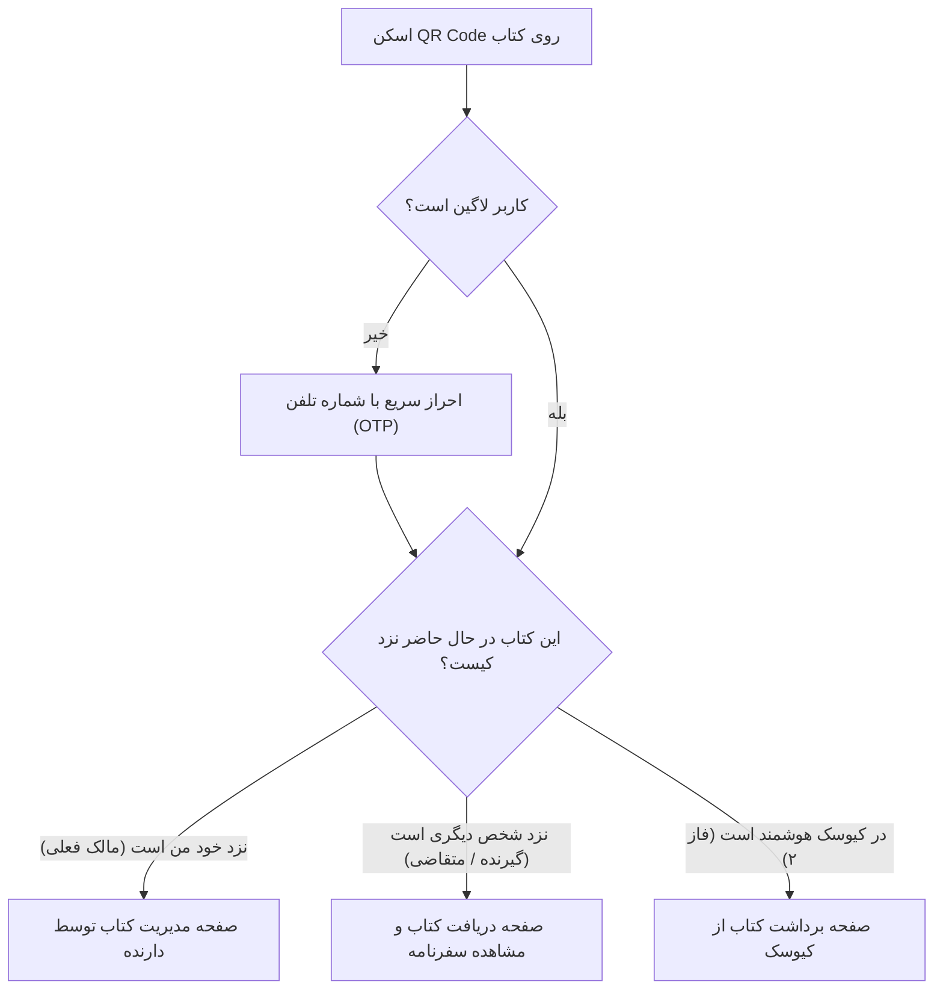

# 📖 سند جامع گردش و اهدای حضوری کتاب در پلتفرم تفاخر
> **Tafakor Book Circulation, In-Person Handover & Smart Kiosk Master Architecture**  
> *تاریخ: ۹ نوامبر ۲۰۲۶ | وضعیت: مصوب و در حال آماده‌سازی فاز ۱*

---

## ۱. بیانیه چشم‌انداز (Vision Statement)
پلتفرم تفاخر علاوه بر بازارچه آنلاین و دونیت‌های مالی، بستر یک **«شبکه اجتماعی گردش فیزیکی کتاب (Book Circulation Network)»** است.
کتاب‌ها در این سیستم هویت فیزیکی یکتا دارند، دست‌به‌دست در ملاقات‌های حضوری افراد هدیه داده می‌شوند، بعدها در ایستگاه‌ها و کیوسک‌های فیزیکی هوشمند تفاخر قرار می‌گیرند، و سرگذشت (سفرنامه) خوانندگان خود را در طول زمان ثبت و حفظ می‌کنند.

---

## ۲. پاسخ به سوالات کلیدی معماری و فرآیند

### ۲.۱. آیا در مارکت‌پلیس هم کاربر باید بتواند کتاب برای اهدا بگذارد؟
**بله، ۱۰۰٪ بله.** به دلایل زیر:
1. **هویت‌بخشی و تولید QR Code:** اولین بار که کاربر کتابی را به عنوان «کتاب اهدایی» در سیستم ثبت می‌کند، رکورد دیجیتال آن ساخته شده و شناسنامه و QR Code کتاب متولد می‌شود.
2. **دیده‌شدن در شهر و تاپیک‌ها:** مخاطبان در سایت یا اپلیکیشن می‌توانند کتاب‌های اهدایی آماده در شهر خود را ببینند و قرار ملاقات حضوری بگذارند.
3. **انعطاف در نحوه تحویل:** اهداکننده می‌تواند مشخص کند که این کتاب:
   * الف) فقط برای **تحویل حضوری در ملاقات‌ها** است.
   * ب) برای **ارسال پستی** هم امکان‌پذیر است.
   * ج) در آینده: در **کیوسک تفاخر** قرار می‌گیرد.

---

### ۲.۲. ساختار بارکد و QR Code برای هر جلد کتاب
هر عنوان کتاب ممکن است صدها نسخه فیزیکی در گردش داشته باشد. بنابراین:
* یک صفحه مرجع برای کتاب وجود دارد (مثلاً: *انسان ۲۵۰ ساله*).
* به ازای هر «جلد فیزیکی کتاب»، یک شناسه یکتای کوتاه و امن (مانند `TK-8492` یا UUID) و یک **QR Code اختصاصی** تولید می‌شود.
* کاربر برچسب یا شناسه را در صفحه اول کتاب می‌چسباند یا یادداشت می‌کند. این بارکد به لینکی مانند زیر متصل است:  
  `https://tafakormag.ir/b/TK-8492` (با پشتیبانی از Deep Link در اپ فلاتر).

---

## ۳. سناریوی اسکن QR Code: رابط کاربری بر اساس نقش کاربر

وقتی دوربین موبایل (یا اپلیکیشن فلاتر تفاخر) بارکد روی کتاب را اسکن می‌کند، سیستم نقش اسکن‌کننده را تشخیص می‌دهد:



---

### ۳.۱. حالت اول: اگر «مالک / دارنده فعلی کتاب» بارکد را اسکن کند
سیستم پیام می‌دهد: **«این کتاب در حال حاضر در دستان شماست»**.

#### اطلاعات و گزینه‌هایی که مالک می‌بیند:
1. **مشخصات کتاب:** نام کتاب، نویسنده، ناشر، عکس جلد، وضعیت ظاهری.
2. **وضعیت گردش:** مدت زمانی که کتاب نزد او بوده است.
3. **دکمه اصلی: «انتقال حضوری به شخص دیگر (اهدا/هدیه)»:**
   * با لمس این دکمه، سیستم یک **«کد تایید ۴ رقمی موقت»** تولید می‌کند یا دوربین اسکنر را باز می‌کند تا بارکد پروفایل گیرنده را بخواند.
4. **دکمه: «ثبت یادداشت و خاطره در سفرنامه کتاب»:**
   * امکان نوشتن چند خط نظر، بریده‌ای از کتاب، یا پیامی انگیزشی برای خواننده بعدی که روی شناسنامه این جلد برای همیشه ثبت می‌شود.
5. **دکمه: «چاپ مجدد برچسب / ذخیره تصویر QR Code»**.

---

### ۳.۲. حالت دوم: اگر «گیرنده یا شخص دیگر» بارکد را اسکن کند
سیستم تشخیص می‌دهد این کتاب متعلق به کاربر دیگری است.

#### اطلاعات و گزینه‌هایی که گیرنده می‌بیند:
1. **مشخصات کتاب:** عنوان، تصویر جلد، نام نویسنده و خلاصه‌ای از کتاب.
2. **شناسنامه دارنده فعلی:** نام یا تصویر اهداکننده (مثلاً: *در دست محمد رضایی*).
3. **سرگذشت و سفرنامه کتاب (Book Journey):**
   * خط زمانی از اینکه این کتاب تاکنون از دست چه کسانی گذشته، در چه تاریخ‌هایی و چه یادداشت‌هایی برای آن گذاشته‌اند.
4. **دکمه اصلی برجسته (Call to Action):**
   * **«دریافت این کتاب در ملاقات حضوری» (Claim Book)**.
   * با لمس این دکمه:
     * کد ۴ رقمی موقت دارنده را وارد می‌کند (یا دارنده درخواست را در گوشی خود تایید می‌زند).
     * به صورت آنی مالکیت کتاب در سیستم به گیرنده جدید منتقل می‌شود.
     * پیام تبریک، نشان افتخار (Badge) برای اهداکننده و گیرنده، و ثبت کتاب در «در حال مطالعه» گیرنده.
5. **اگر در ملاقات حضوری نیستند:** دکمه «درخواست هدیه / ارسال پستی» در صورت تمایل اهداکننده.

---

## ۴. طراحی دیتابیس پایه‌ای (آماده برای اهدا حضوری فعلی + کیوسک‌های آینده)

برای اینکه در آینده نیازی به تغییر یا بازنویسی دیتابیس نباشد، ساختار زیر با کمترین پیچیدگی هر دو فاز را پوشش می‌دهد:

### ۴.۱. مدل کاتالوگ کتاب (`BookCatalog` یا `Item + BookDetail`)
اطلاعات عمومی کتاب: عنوان، شابک، ناشر، نویسنده، خلاصه و عکس رسمی.

### ۴.۲. مدل نسخه فیزیکی کتاب (`BookCopy`)
```python
# جدول اختصاصی هر جلد کتاب فیزیکی
class BookCopy(models.Model):
    class Status(models.TextChoices):
        WITH_USER = 'with_user', 'نزد کاربر'
        IN_KIOSK = 'in_kiosk', 'موجود در کیوسک تفاخر (فاز ۲)'
        IN_TRANSIT = 'in_transit', 'در حال انتقال/ارسال'
        COMPLETED = 'completed', 'بایگانی/پایان گردش'

    id = models.UUIDField(primary_key=True, default=uuid.uuid4)
    short_code = models.CharField(max_length=12, unique=True, db_index=True) # مثلا TK-9842
    item = models.ForeignKey('marketplace.Item', on_delete=models.PROTECT, related_name='copies')
    
    current_holder = models.ForeignKey(settings.AUTH_USER_MODEL, on_delete=models.PROTECT, related_name='held_books')
    original_donor = models.ForeignKey(settings.AUTH_USER_MODEL, on_delete=models.PROTECT, related_name='donated_book_copies')
    
    status = models.CharField(max_length=20, choices=Status.choices, default=Status.WITH_USER)
    current_kiosk = models.ForeignKey('marketplace.BookKiosk', null=True, blank=True, on_delete=models.SET_NULL) # فاز ۲
    
    handover_count = models.PositiveIntegerField(default=0) # تعداد دفعات اهدا/گردش
    created_at = models.DateTimeField(auto_now_add=True)
```

### ۴.۳. مدل تاریخچه انتقال و سفرنامه (`BookHandover`)
```python
class BookHandover(models.Model):
    class Method(models.TextChoices):
        IN_PERSON = 'in_person', 'انتقال و اهدا حضوری'
        KIOSK_DEPOSIT = 'kiosk_deposit', 'تحویل به کیوسک'
        KIOSK_PICKUP = 'kiosk_pickup', 'برداشت از کیوسک'
        POSTAL = 'postal', 'ارسال پستی'

    book_copy = models.ForeignKey(BookCopy, on_delete=models.CASCADE, related_name='handovers')
    from_user = models.ForeignKey(settings.AUTH_USER_MODEL, null=True, blank=True, on_delete=models.PROTECT, related_name='given_handovers')
    to_user = models.ForeignKey(settings.AUTH_USER_MODEL, on_delete=models.PROTECT, related_name='received_handovers')
    
    method = models.CharField(max_length=20, choices=Method.choices, default=Method.IN_PERSON)
    donor_note = models.TextField(blank=True, default='') # یادداشت اهداکننده برای خواننده بعدی
    recipient_feedback = models.TextField(blank=True, default='') # نظر و برداشت گیرنده
    
    transferred_at = models.DateTimeField(auto_now_add=True)
```

### ۴.۴. مدل کیوسک‌ها (`BookKiosk` — آماده‌سازی برای فاز بعدی)
جدول شامل: نام کیوسک، استان، شهر، نشانی دقیق، مختصات جغرافیایی (Latitude/Longitude)، وضعیت فعال بودن، و ظرفیت کل/پر.

---

## ۵. نقشه راه اپلیکیشن فلاتر (Flutter Mobile App)

توسعه اپلیکیشن موبایل با فلاتر برای این سناریو انتخاب فوق‌العاده‌ای است چون:
1. **اسکنر بومی و پرسرعت QR:** بدون نیاز به تاخیرهای مرورگر، با کتابخانه‌های بومی موبایل سریعاً بارکد خوانده می‌شود.
2. **پشتیبانی کامل از هر ۳ بال پلتفرم تفاخر در یک اپلیکیشن یکپارچه:**
   * **بال اول: پویش‌های مالی نیکوکاری (Donations):** مشاهده پویش‌ها، کارت‌های چت و پرداخت آنلاین سریع.
   * **بال دوم: بازارچه (Marketplace):** ثبت کالا و کتاب، سبد خرید، پیگیری سفارشات و بسته‌های پستی.
   * **بال سوم: گردش و اهدای کتاب (Book Circulation):** قفسه کتاب‌های من، اسکنر اهدا حضوری، تاریخچه سفرنامه‌ها و مشاهده کیوسک‌های مجاور روی نقشه.
3. **زیرساخت موجود:** به دلیل حضور سرویس `apps.ota` (Flutter Patcher) در بک‌اند، امکان انتشار آپدیت‌های Over-The-Air برای اپلیکیشن فلاتر از همین حالا پیش‌بینی شده است.

---

## ۶. اقدامات فاز فعلی (Phase 1 Checklist)
- [x] ثبت سند معماری و نیازمندی‌ها در مستندات پروژه.
- [ ] پیاده‌سازی مدل‌های `BookCopy` و `BookHandover` در لایه بک‌اند.
- [ ] پیاده‌سازی سرویس `HandoverService` (شامل متد تولید کد تایید موقت، اسکن و تایید انتقال).
- [ ] ساخت اندپوینت‌های اختصاصی API:
  - `GET /api/v1/marketplace/copies/{short_code}/inspect/`: بررسی وضعیت جلد بر اساس لاگین کاربر.
  - `POST /api/v1/marketplace/copies/{short_code}/transfer-in-person/`: تایید و نهایی‌سازی انتقال حضوری.
- [ ] آماده‌سازی صفحه وب نسخه سبک برای اسکن دوربین در مرورگر (PWA) تا زمان آماده‌شدن اپلیکیشن فلاتر.

