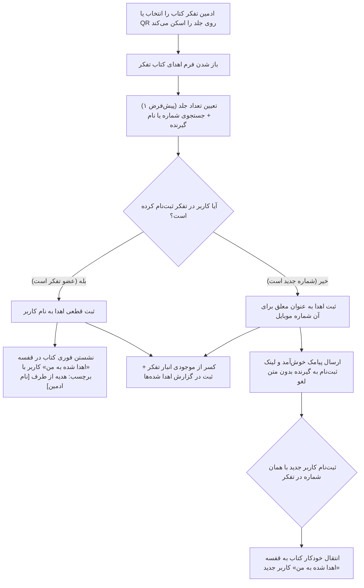

# 📘 مستند جامع سناریوها، قوانین و فرآیند اهدای کتاب در پلتفرم تفکر
> **Tafakor Book Donation, In-Person Handover & Circulation Specification**  
> *تاریخ نگارش: ۲۵ آبان ۱۴۰۵ (16 Nov 2026) | نسخه: ۲.۰ (معماری اهدای سازمانی متمرکز توسط ادمین‌های تفکر)*

---

## ۱. بیانیه معماری و تصمیمات قطعی (Core Architectural Decisions)

در نسخه جدید، پلتفرم تفکر به عنوان **تنها مرجع تأمین‌کننده، ثبت‌کننده و اهداکننده کتاب‌های فرهنگی** عمل می‌کند:

1. **تفکیک قطعی نقش‌ها (Role Segregation):**
   - **ادمین تفکر (`is_staff == True`):** تنها شخصی است که دسترسی به «ثبت کتاب جدید»، «افزایش موجودی انبار»، «اسکن و اهدای کتاب»، و «مشاهده گزارش‌های اهدا» دارد.
   - **کاربر عادی (گیرنده / Recipient):** صرفاً دریافت‌کننده هدایا است. دکمه «ثبت کتاب» و دکمه «اهدا» برای کاربر عادی **کلاً مخفی و ناموجود** است.
2. **انبار متمرکز سازمانی تفکر (Single Unified Inventory):**
   - تمام ادمین‌های تفکر به یک انبار موجودی مشترک سازمانی دسترسی دارند. هر ادمین می‌تواند از این موجودی مشترک کتاب اهدا کند.
3. **تحویل مستقیم و آنی (Zero-Friction Instant Delivery):**
   - دیگر نیازی به تایید یا زدن دکمه «تحویل گرفتم» توسط کاربر گیرنده نیست. به محض ثبت اهدا توسط ادمین، کتاب قطعی وارد قفسه گیرنده می‌شود.
4. **نامگذاری و قفسه کاربر عادی:**
   - قفسه کاربر عادی به **«اهدا شده به من» (کتاب‌های هدیه)** تغییر نام می‌یابد.
   - در کارت هر کتاب، برچسب شفاف درج می‌شود:  
     **«هدیه از طرف: [نام ادمین اهداکننده]»**
   - کاربر عادی دسترسی به ویرایش، حذف یا اهدای مجدد این کتاب‌ها را ندارد و کتاب‌ها تا ابد نزد او می‌ماند.
5. **الگوی بهینه بارکد QR کتاب‌ها (Title / Batch QR Best Practice):**
   - به ازای هر عنوان کتاب در انبار تفکر، یک بارکد/QR اختصاصی (مانند `https://tafakormag.ir/b/TK-RASTAN`) تولید و چاپ می‌شود.
   - نیازی به تولید ۱۰۰۰ کد QR متفاوت برای ۱۰۰۰ جلد از یک عنوان نیست؛ ادمین با اسکن برچسب هر جلد از آن کتاب، فوراً به فرم اهدای آن عنوان هدایت می‌شود.
6. **تعداد جلد در هر اهدا:**
   - پیش‌فرض روی **۱ جلد** تنظیم شده و دارای استپر ساده (`+` و `-`) تا سقف موجودی انبار است تا در صورت نیاز به اهدای چندجلدی (به مدارس، کتابخانه‌ها یا رابطین فرهنگی)، ادمین در یک گام اهدا را ثبت کند.
7. **جستجوی هوشمند کاربران (Autocomplete):**
   - ادمین در فرم اهدا می‌تواند نام یا شماره موبایل کاربر را جستجو کند (از طریق اندپوینت امن ویژه ادمین).
   - اگر کاربر هنوز عضو تفکر نباشد، ادمین روی گزینه «اهدا به این شماره جدید» کلیک می‌کند.
8. **اهدای به کاربران ثبت‌نام‌نشده:**
   - پیامک اطلاع‌رسانی از سرشماره خدماتی به شماره شخص ارسال می‌شود:
     > «سلام! کتاب [نام کتاب] از طرف [نام ادمین] به شما اهدا شد. برای مشاهده در تفکر ثبت‌نام فرمایید: https://tafakormag.ir/dl»
   - به محض ثبت‌نام کاربر با آن شماره تلفن، سیستم رکوردهای معلق اهدایی را شناسایی کرده و خودکار در قفسه «اهدا شده به من» او قرار می‌دهد.
9. **تب‌های اختصاصی ادمین در انبار کتاب‌ها:**
   - **تب ۱: کتاب‌های موجود (انبار تفکر):** مشاهده عناوین، موجودی آزاد، افزایش موجودی، ویرایش مشخصات، و دکمه اهدا.
   - **تب ۲: گزارش اهدا شده‌ها (Audit Log):** گزارش تفصیلی و غیرقابل تغییر شامل: نام کتاب، تعداد جلد، نام ادمین اهداکننده، نام و شماره گیرنده، تاریخ و زمان دقیق. (این تب صرفاً گزارش است و امکان بازگرداندن به انبار در آن وجود ندارد).
10. **حفظ داده‌ها و امنیت سوابق (Soft Delete):**
    - در صورت حذف یک عنوان از انبار موجودی، سوابق اهداهای قبلی و کتاب‌های نشانده‌شده در قفسه کاربران به هیچ عنوان حذف یا خراب نمی‌شوند (Soft-delete با حفظ سلامت رابطه خارجی).

---

## ۲. جریان اصلی فرآیند اهدا (Workflow Diagram)

---

## ۳. رابط کاربری و تجربه کاربران در دو سطح

### ۳.۱. پنل و قفسه ادمین تفکر (`Admin Bookshelf & Inventory`)
- **هدر صفحه:** دکمه «ثبت کتاب جدید»، دکمه «اسکن سریع بارکد کتاب».
- **تب اول (کتاب‌های موجود تفکر):**
  - کارت‌های کتاب‌ها شامل تصویر جلد، عنوان، نویسنده، و موجودی آزاد.
  - دکمه برجسته مشکی **«اهدا»** روی هر کارت.
  - دکمه‌های ثانویه «افزایش موجودی» و «ویرایش مشخصات».
- **تب دوم (گزارش اهدا شده‌ها):**
  - جدول / لیست زمانی اهداها.
  - نمایش: عکس و نام کتاب | تعداد جلد | گیرنده (نام و شماره تلفن) | اهداکننده (نام ادمین) | تاریخ و ساعت.
  - حالت کاملاً خواندنی (Read-only) جهت حفظ یکپارچگی حسابداری و گزارش‌های فرهنگی.

### ۳.۲. صفحه کاربر عادی («اهدا شده به من / کتاب‌های هدیه»)
- **در صفحه اصلی (هوم):**
  - ردیف اختصاصی با عنوان **«کتاب‌های اهدایی به شما»**.
- **در صفحه قفسه کتاب:**
  - عنوان صفحه: **«اهدا شده به من»**.
  - **فقدان هرگونه دکمه ثبت یا اهدا.**
  - کارت‌های کتاب با طراحی تمیز شامل تصویر جلد، عنوان کتاب، نام نویسنده و نشان سبز زمردی:  
    `🎁 هدیه از طرف [نام ادمین]`
  - با ضربه زدن روی کارت: باز شدن یک دیالوگ زیبا شامل عکس بزرگ جلد، مشخصات، توضیحات کتاب و تاریخ دریافت.

---

## ۴. ماتریس دسترسی‌ها و امنیت (Access Control Matrix)

| قابلیت / اکشن | کاربر عادی (مهمان/لاگین) | ادمین تفکر (`is_staff=True`) | منطق و علت |
|---|---|---|---|
| **ثبت کتاب در انبار** | ❌ غیرمجاز (دکمه مخفی) | ✅ مجاز | فقط تفکر مرجع تأمین کتاب است. |
| **ویرایش یا حذف از انبار** | ❌ غیرمجاز | ✅ مجاز | مدیریت کاتالوگ و موجودی با ادمین است. |
| **جستجوی لیست کاربران** | ❌ مسدود (پروتکل حریم خصوصی) | ✅ مجاز (انحصاری ادمین) | ادمین برای اهدا نیاز به یافتن شخص دارد. |
| **اهدای کتاب به شماره** | ❌ غیرمجاز | ✅ مجاز | اهدا منحصراً توسط تفکر صورت می‌گیرد. |
| **مشاهده گزارش اهدا شده‌ها** | ❌ غیرمجاز | ✅ مجاز | گزارش سازمانی انحصاری مدیران است. |
| **مشاهده کتاب‌های قفسه خود** | ✅ مجاز («اهدا شده به من») | ✅ مجاز | هر کاربر هدایای خود را می‌بیند. |
| **ویرایش کتاب هدیه** | ❌ غیرمجاز | ❌ غیرمجاز | کتاب‌های هدیه داده‌شده غیرقابل دستکاری هستند. |
| **اهدای مجدد کتاب هدیه** | ❌ غیرمجاز | ❌ غیرمجاز | کتاب هدیه پیش کاربر می‌ماند و در چرخه نیست. |

---

## ۵. سناریوهای لبه و تدابیر سیستم (Edge Cases)

1. **اهدای چندباره یک کتاب به یک کاربر:**
   - اگر ادمین کتابی را که قبلاً به کاربر اهدا شده مجدداً به او اهدا کند، رکورد موجود در قفسه کاربر با تعداد جدید جمع می‌شود (مثلاً تعداد جلد از ۱ به ۲ افزایش می‌یابد).
2. **ثبت‌نام دیرهنگام کاربر دریافت‌کننده:**
   - سیگنال ثبت‌نام کاربر در بکند (`post_save` روی مدل `User`)، شماره تلفن ثبت‌نام‌شده را با رکوردهای اهدای معلق مطابقت داده و آن‌ها را به حساب کاربر متصل می‌کند.
3. **موجودی صفر در انبار تفکر:**
   - اگر موجودی کتابی در انبار به صفر برسد، دکمه «اهدا» در تب موجودی غیرفعال (Disabled) شده و دکمه «+ افزایش موجودی» به ادمین پیشنهاد می‌شود.
4. **حذف کتاب دارای سابقه اهدا:**
   - حذف فیزیکی از دیتابیس صورت نمی‌گیرد؛ پرچم `is_deleted = True` ثبت شده تا رکوردهای قبلی هدیه در حساب کاربران همچنان دارای ارجاع سالم باشند.
