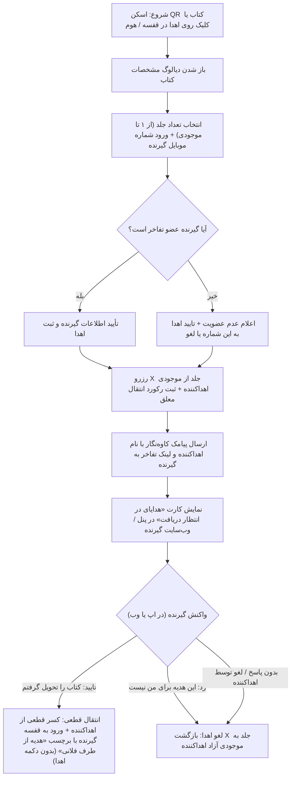

# 📘 مستند جامع سناریوهای اهدای حضوری کتاب و گردش در پلتفرم تفاخر
> **Tafakor Book Donation, In-Person Handover & Circulation Specification**  
> *تاریخ نگارش: ۲۴ آبان ۱۴۰۵ (14 Nov 2026) | وضعیت: مصوب و آماده پیاده‌سازی*

---

## ۱. تصمیمات قطعی و اصول طراحی (Design Decisions)

1. **اهدای چند جلدی (Multi-copy Donation):**
   - اهداکننده می‌تواند مشخص کند چند جلد (از ۱ تا سقف موجودی قفسه خود) را به گیرنده اهدا می‌کند.
2. **نمایش برچسب هدیه در قفسه گیرنده:**
   - زیر کارت کتاب در قفسه گیرنده، به‌صورت واضح نوشته می‌شود:  
     **«هدیه از طرف: [نام یا شماره اهداکننده]»**
3. **قفل بودن اهدای مجدد توسط گیرنده (فعلاً):**
   - گیرنده‌ای که کتابی را به عنوان هدیه دریافت کرده است، **نمی‌تواند** آن کتاب را به فرد دیگری اهدا کند. دکمه «اهدا» برای کتاب‌های هدیه‌گرفته‌شده در قفسه گیرنده نمایش داده نمی‌شود.
4. **حذف یادداشت و اهدای ناشناس (فعلاً):**
   - فرم اهدا فوق‌العاده سریع و ساده است: فقط **تعداد جلد** و **شماره موبایل گیرنده**.
   - اهدای ناشناس وجود ندارد؛ نام اهداکننده همیشه در پیامک و قفسه گیرنده درج می‌شود.

---

## ۲. جریان اصلی سناریو (Core Workflow)

---

## ۳. گام‌های جزئی فرآیند اهدا

### گام ۱: انتخاب کتاب و ورود به فرم اهدا
- از طریق **اسکن QR روی کتاب فیزیکی** (در اپ فلاتر یا مرورگر موبایل) یا از طریق دکمه مشکی **«اهدا»** در کارت‌های قفسه کتاب / هوم.

### گام ۲: مشخصات اهدا و گیرنده
- اهداکننده در فرم موارد زیر را مشخص می‌کند:
  1. **تعداد جلد اهدایی:** استپر تعداد جلد (از ۱ تا حداکثر موجودی کتاب).
  2. **شماره موبایل گیرنده:** (و نام در صورت دلخواه).
- بررسی سیستم:
  - **اگر عضو باشد:** نام او نمایش داده می‌شود.
  - **اگر عضو نباشد:** هشدار داده می‌شود که کاربر عضو تفاخر نیست، اما اهداکننده می‌تواند باز هم اهدا را ثبت کند.

### گام ۳: ثبت رکورد و ارسال پیامک کاوه‌نگار
- با فشردن دکمه ثبت:
  1. تعداد جلدهای اهدایی از موجودی آزاد اهداکننده کسر و در حالت **«رزرو اهدا»** قرار می‌گیرد.
  2. رکورد انتقال با وضعیت `pending_recipient` ایجاد می‌شود.
  3. پیامک کاوه‌نگار برای گیرنده فرستاده می‌شود:
     > *«سلام [نام گیرنده] عزیز، [تعداد] جلد کتاب [نام کتاب] از طرف [نام اهداکننده] به شما اهدا شد. برای مشاهده و تأیید تحویل کلیک کنید: [لینک اختصاصی تفاخر]»*

### گام ۴: تایید تحویل و انتقال مالکیت
- گیرنده با باز کردن لینک یا ورود به اپلیکیشن، در بخش **«هدایای در انتظار دریافت»**، کارت کتاب را می‌بیند.
- گیرنده روی **«کتاب را تحویل گرفتم»** می‌زند (یا بارکد کتاب را با دوربین گوشی اسکن می‌کند).
- بلافاصله:
  - تعداد جلد از اهداکننده کسر قطعی می‌شود.
  - کتاب وارد قفسه گیرنده می‌شود.
  - زیر کارت کتاب در قفسه گیرنده نوشته می‌شود: **«هدیه از طرف: [نام اهداکننده]»**.
  - دکمه «اهدا» روی این کتاب در قفسه گیرنده **غیرفعال / پنهان** است (گیرنده نمی‌تواند آن را به دیگری اهدا کند).

---

## ۴. مدیریت وضعیت‌های غیرمنتظره و استثناها (Edge Cases)

| # | وضعیت غیرمنتظره | سناریوی رخداد | راهکار و منطق سیستم |
|---|---|---|---|
| **۱** | **اشتباه در شماره موبایل** | اهداکننده شماره را اشتباه وارد کرده است. | اهداکننده تا پیش از تأیید گیرنده، می‌تواند دکمه **«لغو اهدا»** را بزند تا کتاب فوراً آزاد شود. همچنین گیرنده اشتباهی دکمه **«این هدیه برای من نیست»** دارد. |
| **۲** | **لغو توسط اهداکننده** | قرار ملاقات لغو شده یا گیرنده کتاب را تحویل نگرفته است. | اهداکننده در قفسه خود وضعیت «در انتظار تحویل به فلانی» را می‌بیند و با زدن **«لغو اهدا»**، جلدهای رزروشده به موجودی آزاد او برمی‌گردد. |
| **۳** | **رزرو موقت موجودی (Stock Locking)** | جلوگیری از اهدای دوباره جلدهای رزروشده. | تا زمان تایید یا لغو، تعداد جلدهای انتخاب‌شده قفل می‌مانند و اهداکننده نمی‌تواند آنها را به شخص دیگری واگذار کند. |
| **۴** | **ثبت‌نام دیرهنگام گیرنده** | گیرنده چند روز بعد در سایت یا اپ ثبت‌نام می‌کند. | به محض ایجاد حساب با آن شماره تلفن، سیستم رکوردهای معلق اهدایی به آن شماره را پیدا کرده و بنر تایید هدیه را در حساب جدید نمایش می‌دهد. |
| **۵** | **انقضای زمان (Timeout)** | گیرنده واکنشی نشان نمی‌دهد یا ثبت‌نام نمی‌کند. | پس از مهلت مشخص (مثلاً ۱۰ روز)، وضعیت به `expired` تغییر کرده و جلدها خودکار به موجودی اهداکننده بازمی‌گردند. |
| **۶** | **اهدای حضوری با اسکن QR** | دو نفر کنار هم هستند و کتاب تحویل داده می‌شود. | اسکن بارکد کتاب توسط دوربین گیرنده مستقیماً تحویل را اثبات و تراکنش را نهایی می‌کند. |
