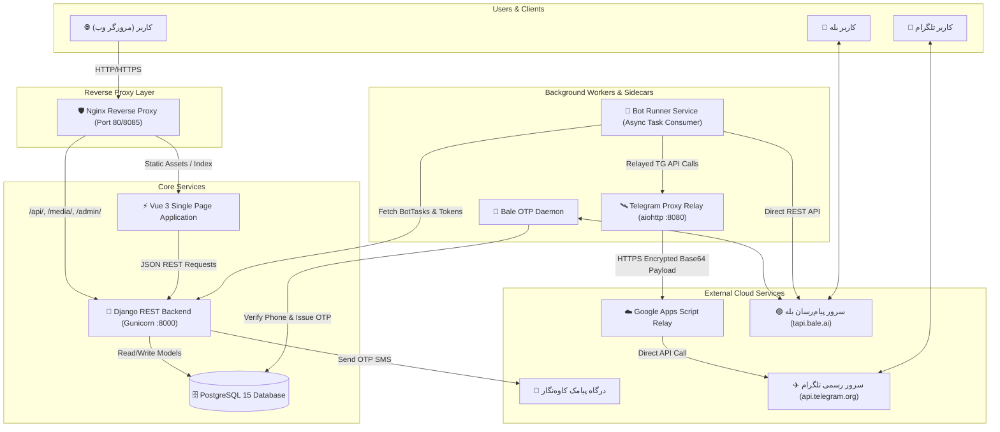
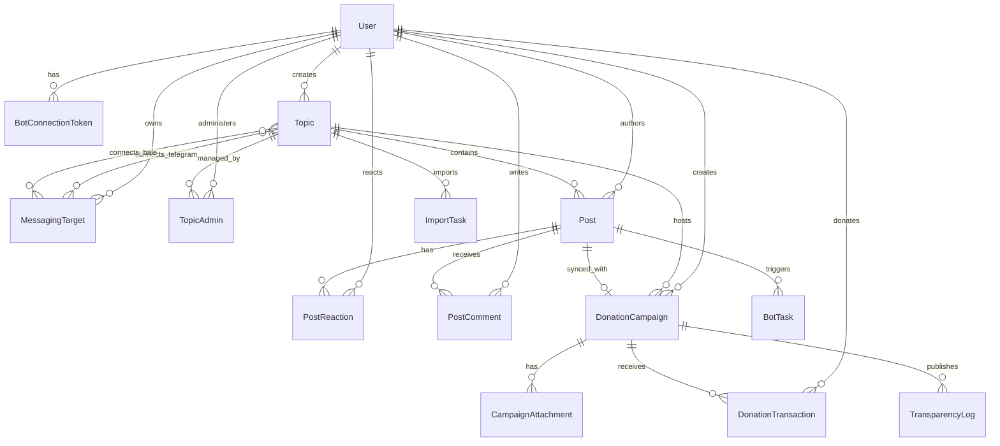
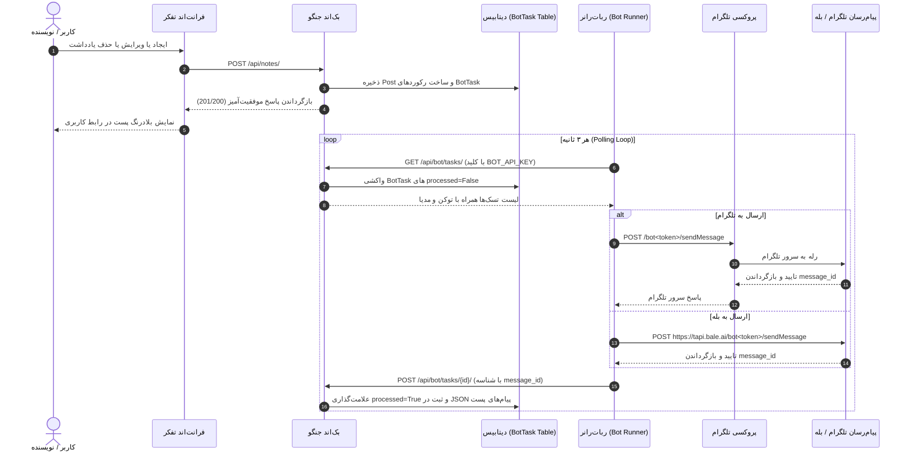
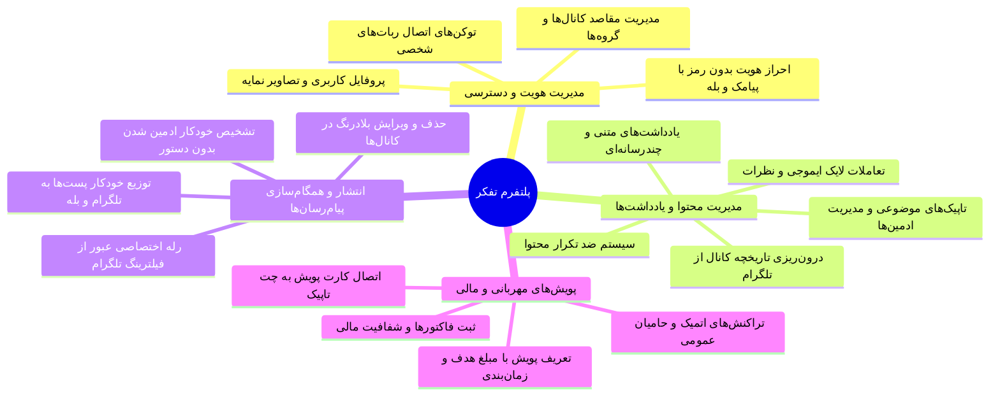

# 🏛️ معماری و مستندات جامع پلتفرم تفکر (Tafakor Project Overview)

> **سند مرجع مهندسی و معماری سیستم (Staff Engineer / Architectural Reference Document)**  
> این مستند به عنوان راهنمای جامع و نقشه جامع فنی سیستم طراحی شده است تا هر مهندس نرم‌افزار، معمار سیستم یا مدل هوش مصنوعی (LLM) بتواند بدون نیاز به اسکن کل پایگاه کد، درک عمیق، دقیق و کد‌به‌کد از معماری، جریان داده، دامنه کسب‌وکار و زیرساخت پروژه به دست آورد.

---

## ۱. خلاصه اجرایی (Executive Summary)

### ۱.۱. معرفی پلتفرم
**تفکر (Tafakor)** یک پلتفرم جامع انتشار، دسته‌بندی و تعامل یادداشت‌ها، کانال‌های موضوعی (Topics) و تأمین مالی جمعی خیریه (Crowdfunding / Kindness) است که به طور مستقیم و دوطرفه با پیام‌رسان‌های **تلگرام (Telegram)** و **بله (Bale)** یکپارچه شده است.

### ۱.۲. مسئله و ارزش پیشنهادی
مدیران کانال‌ها، وبلاگ‌نویسان و گردانندگان جوامع در ایران برای مدیریت محتوا و ارتباط با مخاطبان با چالش‌های بزرگی مواجه هستند:
1. فیلترینگ و مسدود بودن دسترسی مستقیم به تلگرام روی سرورهای داخلی
2. پراکندگی محتوا میان پلتفرم‌های پیام‌رسان بومی (بله) و بین‌المللی (تلگرام)
3. نبود آرشیو غنی، دسته‌بندی‌شده و قابل جستجو در وب برای پست‌های کانال‌ها
4. پیچیدگی مدیریت پویش‌های نیکوکاری و جمع‌آوری مبالغ شفاف مالی

**تفکر این مسائل را با راهکارهای زیر حل می‌کند:**
- **Single Source of Truth:** ایجاد و ویرایش پست در وب‌سایت و همگام‌سازی بلادرنگ با کانال‌ها و گروه‌های تلگرام و بله.
- **Bypass Relay Proxy:** ایجاد پروکسی اختصاصی هوشمند بدون نیاز به VPN برای برقراری ارتباط سرورهای ایران با تلگرام از طریق Google Apps Script و Cloudflare Workers.
- **Zero-Command Bot Management:** تشخیص خودکار ادمین شدن ربات اختصاصی کاربر در کانال‌ها/گروه‌ها بدون نیاز به اجرای دستور متنی.
- **Kindness & Transparency Engine:** سامانه کامل پویش‌های مالی با تراکنش‌های اتمیک مالی و گزارش‌دهی شفاف فاکتورها.
- **High-Performance Importer:** موتور درون‌ریزی ناهمگام فایل‌های آرشیو JSON و ZIP تلگرام همراه با استخراج مدیا و به‌روزرسانی زنده پیشرفت.

### ۱.۳. ساختار پشته فناوری (Tech Stack Matrix)

| لایه | فناوری‌های کلیدی | نسخه / کتابخانه‌ها |
| :--- | :--- | :--- |
| **Frontend** | Vue 3, Vite, TypeScript | Vue 3.5+, Vite 8.0+, Pinia 3.0+, Vue Router 5.1+, Tailwind CSS 4.3+, shadcn-vue (Reka UI), Lucide Icons |
| **Backend** | Python, Django, DRF | Python 3.11, Django 5.2+, Django REST Framework 3.16+, Gunicorn 21+, django-cors-headers, python-decouple |
| **Bots & Automation** | Python Asyncio | python-telegram-bot 20.7+, httpx, aiohttp |
| **Database & Cache** | PostgreSQL / SQLite | PostgreSQL 15 (تولید/داکر), SQLite 3 (توسعه محلی), Django Database Cache |
| **Proxy Gateway** | Python Aiohttp, JS Relay | Google Apps Script Engine, Cloudflare Worker (V8 Engine) |
| **Infrastructure & CI** | Docker, Nginx, Compose | Multi-stage Docker, Alpine Linux, Nginx Stable (Reverse Proxy) |
| **Quality & Testing** | Pytest, Playwright | Pytest 8+, pytest-django, pytest-playwright, pytest-cov |

---

## ۲. ساختار ریپازیتوری (Repository Structure)

```text
/ (Project Root)
├── .agents/                                # تنظیمات و مهارت‌های عامل‌های هوشمند (Skills)
│   └── skills/                             # مهارت‌های سفارشی monorepo-management, shadcn, shadcn-vue
├── backend/                                # سرویس اصلی جنگو و وب‌سرویس‌های REST
│   ├── apps/
│   │   ├── accounts/                       # مدیریت کاربران، احراز هویت، OTP و ربات‌های شخصی
│   │   │   ├── migrations/                 # مایگریشن‌های دیتابیس کاربران و توکن‌ها
│   │   │   ├── admin.py                    # تنظیمات پنل ادمین جنگو برای حساب‌ها
│   │   │   ├── apps.py                     # پیکربندی اپلیکیشن Accounts
│   │   │   ├── bot_views.py                # وب‌سرویس‌های اختصاصی مصرفی ربات‌رانر
│   │   │   ├── models.py                   # مدل‌های User, BotConnectionToken, MessagingTarget
│   │   │   ├── serializers.py              # سریالایزرهای احراز هویت و مشخصات کاربری
│   │   │   ├── services.py                 # سرویس ارسال SMS کاوه‌نگار و منطق اعتبارسنجی
│   │   │   ├── tests.py                    # تست‌های واحد OTP و اعتبارسنجی تلفن
│   │   │   ├── urls.py                     # مسیرهای /api/auth/
│   │   │   └── views.py                    # ویوست AuthViewSet (ورود، تایید، پروفایل، مقاصد)
│   │   ├── notes/                          # مدیریت تاپیک‌ها، پست‌ها، واکنش‌ها، کامنت‌ها و درون‌ریزی
│   │   │   ├── migrations/                 # مایگریشن‌های دیتابیس تاپیک و پست
│   │   │   ├── admin.py                    # تنظیمات پنل ادمین
│   │   │   ├── apps.py                     # پیکربندی اپلیکیشن Notes
│   │   │   ├── bot_permissions.py          # گارد امنیتی IsBotService با کلید X-Bot-Service-Key
│   │   │   ├── bot_urls.py                 # مسیرهای /api/bot/
│   │   │   ├── bot_views.py                # وب‌سرویس‌های تسک‌های ربات و پیوند چت
│   │   │   ├── models.py                   # مدل‌های Topic, Post, PostReaction, PostComment, BotTask, ImportTask, TopicAdmin
│   │   │   ├── permissions.py              # گارد IsTopicOwnerOrAdmin
│   │   │   ├── serializers.py              # سریالایزرهای پست، تاپیک، کامنت، ادمین و ایمپورت
│   │   │   ├── services.py                 # صف BotTask، حذف انتخابی، هپپ ضد تکرار، پردازشگر ZIP/JSON
│   │   │   ├── signals.py                  # سیگنال‌های جنگو
│   │   │   ├── tests.py                    # تست‌های جامع سرویس یادداشت‌ها
│   │   │   ├── urls.py                     # مسیرهای /api/notes/
│   │   │   └── views.py                    # ویوست‌های TopicViewSet, PostViewSet, ImportTaskViewSet
│   │   └── donations/                      # ماژول پویش‌های مهربانی و پرداخت مالی
│   │       ├── migrations/                 # مایگریشن‌های پویش و تراکنش‌ها
│   │       ├── tests/                      # تست‌های مدل، سرویس و API پرداخت
│   │       │   ├── test_api.py             # تست اندپوینت‌های لیست، جزییات و پرداخت
│   │       │   ├── test_models.py          # تست صحت اعتبارسنجی مقادیر فیلدها
│   │       │   └── test_services.py        # تست اتمیک بودن تسویه مالی و جلوگیری از Race Condition
│   │       ├── admin.py                    # پنل مدیریت پویش‌ها و گزارش‌های شفافیت
│   │       ├── apps.py                     # پیکربندی اپلیکیشن Donations
│   │       ├── models.py                   # مدل‌های DonationCampaign, DonationTransaction, TransparencyLog, CampaignAttachment
│   │       ├── serializers.py              # سریالایزرهای پویش، حامیان، گزارش شفافیت و شروع پرداخت
│   │       ├── services.py                 # تراکنش‌های مالی اتمیک (select_for_update, F-expressions)
│   │       ├── urls.py                     # مسیرهای /api/v1/donations/
│   │       └── views.py                    # ویوهای لیست، جزییات، وریفای پرداخت و فاکتورها
│   ├── note_platform/                      # هسته تنظیمات جنگو (Project Root)
│   │   ├── asgi.py                         # رابط ناهمگام ASGI
│   │   ├── settings.py                     # تنظیمات یکپارچه جنگو، دیتابیس، کش، لاگ و احراز هویت
│   │   ├── urls.py                         # مسیریابی اصلی کل پروژه و سرو فایل‌های مدیا
│   │   └── wsgi.py                         # رابط WSGI برای سرور Gunicorn
│   ├── otp/                                # دیسپچر و سرویس ربات عمومی OTP
│   │   ├── bale_bot.py                     # ربات اختصاصی احراز هویت با اشتراک مخاطب در بله
│   │   └── dispatcher.py                   # روتر توزیع کدهای تایید (SMS کاوه‌نگار / کنسول دیباگ)
│   ├── media/                              # فایل‌های آپلود شده (تصاویر پروفایل، تاپیک، پست، فاکتورها)
│   ├── staticfiles/                        # فایل‌های استاتیک جمع‌آوری‌شده جنگو
│   ├── Dockerfile                          # ایمیج بر پایه Python 3.11-slim با Mirror Fallback
│   ├── entrypoint.sh                       # اسکریپت اجرای مایگریشن‌ها و استارت سرور
│   ├── manage.py                           # ابزار خط فرمان جنگو
│   └── requirements.txt                    # پکیج‌های پایتونی بک‌اند
├── frontend/                               # رابط کاربری کلاینت (Vue 3 Single Page Application)
│   ├── public/                             # فایل‌های استاتیک عمومی (آیکون، لوگو، مانیفست)
│   ├── src/
│   │   ├── api/
│   │   │   └── index.ts                    # کلاینت Axios مرکزی همراه با Interceptors و متدهای API
│   │   ├── assets/                         # استایل‌های سراسری، متغیرهای Tailwind و تایپوگرافی
│   │   ├── components/                     # کامپوننت‌های ماژولار و رابط کاربری
│   │   │   ├── common/                     # ابزارهای ویرایش متن، فرمت‌دهی شناور و نمایش متن
│   │   │   ├── kindness/                   # کامپوننت‌های پویش‌های مهربانی (کارت، دیالوگ ساخت، فید)
│   │   │   ├── marketplace/                # کارت‌های ماژول بازارچه اپلیکیشن‌ها
│   │   │   ├── ui/                         # کامپوننت‌های پایه طراحی بر اساس shadcn-vue / Reka UI
│   │   │   ├── AIRefinerDrawer.vue         # کشوی هوش مصنوعی بازنویسی و غنی‌سازی متن
│   │   │   ├── BotConnectionCard.vue       # کارت وضعیت و اتصال ربات تلگرام/بله
│   │   │   ├── CreateTopicModal.vue        # مودال ایجاد تاپیک موضوعی جدید
│   │   │   ├── DuplicateWarningDialog.vue  # هشدار هوشمند جلوگیری از ارسال محتوای تکراری
│   │   │   ├── EditProfileModal.vue        # مودال ویرایش نام و تصویر نمایه
│   │   │   ├── LoginCard.vue               # فرم ورود مرحله‌ای با شماره موبایل و کد ۴ رقمی
│   │   │   ├── PlatformHeader.vue          # نوار ناوبری بالای صفحه با تب‌ها و جستجو
│   │   │   ├── PlatformNavigation.vue      # منوی ناوبری سایدبار
│   │   │   ├── PostCard.vue                # کارت نمایش یادداشت (شامل مدیا، لایک، کامنت، منوی زمینه)
│   │   │   ├── PostContextMenu.vue         # منوی عملیات پست (ویرایش، حذف انتخابی، کپی)
│   │   │   ├── TopicAdminsView.vue         # مدیریت ادمین‌های تاپیک و انتقال مالکیت
│   │   │   ├── TopicCard.vue               # کارت لیست تاپیک در سایدبار
│   │   │   ├── TopicConnectionsView.vue    # مدیریت کانال‌ها و گروه‌های متصل به تاپیک
│   │   │   ├── TopicEditView.vue           # فرم ویرایش عنوان، تصویر و توضیحات تاپیک
│   │   │   ├── TopicImportView.vue         # رابط آپلود و رهگیری پیشرفت درون‌ریزی تلگرام
│   │   │   ├── TopicMessageInput.vue       # کادر پیشرفته درج یادداشت با پیوست فایل
│   │   │   └── UserProfileCard.vue         # کارت نمایش و مدیریت پروفایل کاربر
│   │   ├── lib/
│   │   │   └── utils.ts                    # توابع کمکی ترکیب کلاس‌های CSS با clsx و tw-merge
│   │   ├── router/
│   │   │   ├── index.ts                    # روتر اصلی اپلیکیشن با گاردهای احراز هویت
│   │   │   └── labsRouter.ts               # روتر محیط آزمایشگاهی کامپوننت‌ها (Labs)
│   │   ├── stores/                         # مدیریت وضعیت متمرکز با Pinia
│   │   │   ├── botStore.ts                 # وضعیت ربات‌های شخصی و عمومی
│   │   │   ├── languageStore.ts            # تنظیمات زبان و جهت‌گیری راست‌به‌چپ (RTL)
│   │   │   ├── postStore.ts                # وضعیت پست‌ها، واکنش‌ها، صفحه‌بندی و کامنت‌ها
│   │   │   ├── toastStore.ts               # مدیریت سیستم اعلانات و پیام‌های Toast
│   │   │   ├── topicStore.ts               # وضعیت تاپیک جاری و لیست تاپیک‌های کاربر
│   │   │   └── userStore.ts                # وضعیت احراز هویت، اطلاعات کاربر و توکن
│   │   ├── types/                          # تعاریف تایپ‌های TypeScript (مهربانی، بازارچه)
│   │   ├── utils/                          # ابزارهای تبدیل اعداد فارسی و فرمت‌بندی تاریخ
│   │   ├── views/
│   │   │   ├── FeedView.vue                # نمای اصلی فید (ترکیب تاپیک‌ها، پست‌ها، چت و مهربانی)
│   │   │   ├── HomeView.vue                # نمای ورود و خوش‌آمدگویی
│   │   │   └── playground/                 # محیط‌های تستی کامپوننت‌ها
│   │   ├── App.vue                         # کامپوننت ریشه فرانت‌اند
│   │   └── main.ts                         # نقطه ورود Vue، رجیستر پلاگین‌ها و مونت برنامه
│   ├── components.json                     # پیکربندی Shadcn-Vue
│   ├── Dockerfile                          # ایمیج Multi-stage (Dev -> Build -> Nginx Production)
│   ├── nginx.conf                          # کانفیگ Nginx به عنوان Reverse Proxy برای وب‌سرویس و SPA
│   ├── package.json                        # نیازمندی‌های Node.js و اسکریپت‌های بیلد
│   ├── tsconfig.json                       # پیکربندی کامپایلر TypeScript
│   └── vite.config.ts                      # تنظیمات Vite، پلاگین Vue و مسیرهای مستعار (@)
├── bot_runner/                             # سرویس ناهمگام مدیریت و اجرای ربات‌ها
│   ├── api_client.py                       # کلاینت ارتباط HTTP ناهمگام با بک‌اند جنگو
│   ├── bale_bot.py                         # هندلرهای کتابخانه Bale (در صورت استفاده مجزا)
│   ├── config.py                           # بارگذاری متغیرهای محیطی و مسیرهای API
│   ├── Dockerfile                          # ایمیج اجرای ربات‌رانر پایتون
│   ├── logger_config.py                    # تنظیمات ساختاریافته لاگینگی ربات‌ها
│   ├── main.py                             # حلقه ناهمگام اصلی، Task Processor، Dynamic Worker Manager
│   ├── requirements.txt                    # نیازمندی‌های کتابخانه‌ای ربات‌رانر
│   └── telegram_bot.py                     # هندلرهای اختصاصی تلگرام
├── telegram_proxy/                         # سرویس پروکسی معکوس برای عبور از فیلترینگ تلگرام
│   ├── Dockerfile                          # ایمیج کانتینر محلی پروکسی بر پایه aiohttp
│   ├── gas.js                              # اسکریپت Google Apps Script (رله سمت سرورهای گوگل)
│   ├── local_proxy.py                      # سرور محلی aiohttp برای رهگیری و رله بسته‌ها
│   ├── requirements.txt                    # وابستگی‌های aiohttp
│   └── worker.js                           # اسکریپت Cloudflare Worker (رله جایگزین روی کلودفلر)
├── tests/                                  # فریم‌ورک و کدهای تست سرتاسری و یکپارچه‌سازی
│   ├── artifacts/                          # تصاویر اسکرین‌شات ثبت‌شده در زمان شکست تست‌های E2E
│   ├── e2e/
│   │   └── test_critical_path.py           # تست‌های مرورگر Playwright (مسیر بحرانی لاگین، پست، ربات)
│   ├── integration/
│   │   ├── test_bot_api.py                 # تست وب‌سرویس‌های ربات در بک‌اند
│   │   ├── test_bot_handlers.py            # تست پردازش پیام‌های ربات
│   │   ├── test_bot_runner.py              # تست چرخه‌های کاری Task Processor و Rate Limiting
│   │   ├── test_donations_api.py           # تست کامل اندپوینت‌ها و منطق پولی پویش‌های مهربانی
│   │   ├── test_notes_api.py               # تست دسترسی‌های تاپیک، پست و تولید وظایف ربات
│   │   └── test_telegram_proxy.py          # تست صحت انکپسولیشن و پاسخگویی پروکسی
│   ├── conftest.py                         # تنظیمات pytest، فیکسچرهای دیتابیس مشترک و هوک‌های اسکرین‌شات
│   ├── Dockerfile                          # ایمیج اختصاصی تست‌رانر شامل Playwright Chromium و Pytest
│   ├── pytest.ini                          # پیکربندی Pytest
│   └── testplan.md                         # مستند تفصیلی ۳۵ سناریوی تست
├── docker-compose.yml                      # تعریف سرویس‌های محیط توسعه و پروداکشن
├── docker-compose.test.yml                 # محیط ایزوله و کامل اجرای تست‌های خودکار
├── pytest.ini                              # تنظیمات Pytest ریشه پروژه
├── run-tests.ps1                           # اسکریپت PowerShell اجرای خودکار تست‌ها با داکر
├── run-tests.sh                            # اسکریپت Bash لینوکس اجرای خودکار تست‌ها با داکر
├── .env                                    # فایل پیکربندی متمرکز متغیرهای محیطی
└── README.md                               # راهنمای اجرایی و استقرار سیستم
```

---

## ۳. تحلیل معماری (Architecture Overview)

### ۳.۱. الگوی معماری: Modular Monolith با رویکرد Event-Driven Async Worker
سیستم بر اساس معماری **Modular Monolith با کانتینرهای همکار (Collaborating Sidecars)** پیاده‌سازی شده است:
1. **هسته پردازش (Core Backend):** جنگو به عنوان مرکز ثقل پایگاه داده، احراز هویت، اعتبارسنجی منطق تجاری و مدیریت دسترسی‌ها (RBAC) عمل می‌کند.
2. **کلاینت وب (SPA Frontend):** تک صفحه‌ای مدرن با Vue 3 و Pinia که از طریق REST API با بک‌اند گفتگو می‌کند و با وب‌سرور Nginx بهینه و توزیع می‌شود.
3. **موتور ناهمگام وظایف ربات (Bot Runner Service):** به صورت مستقل در قالب یک پروسس پایتونی ناهمگام (`asyncio`) اجرا می‌شود. هرگونه تغییر در محتوای پست‌ها در دیتابیس یک رکورد `BotTask` ایجاد می‌کند و ربات‌رانر با فرکانس ۳ ثانیه‌ای تسک‌ها را Pull کرده و به پیام‌رسان‌ها ارسال می‌نماید.
4. **رله پروکسی هوشمند (Proxy Sidecar):** کانتینر اختصاصی جهت حل مساله تحریم و فیلترینگ تلگرام بدون نیاز به نصب VPN یا باز کردن پورت‌های ناامن.



---

## ۴. نمودار وابستگی سرویس‌ها (Dependency Graph)

### ۴.۱. ماتریس ارتباطات بین‌سرویسی

```text
[Frontend (Vue 3 / Nginx)]
   │
   ├── (REST API) ──> [Backend Django API (:8000)]
   │                     │
   │                     ├── (SQL Engine) ──────> [PostgreSQL DB (:5432)]
   │                     │
   │                     ├── (SMS Gateway) ─────> [Kavenegar REST API]
   │                     │
   │                     └── (Task Storage) ────> [BotTask Table]
   │                                                 ▲
   └── (Media / Static) ──> [Nginx Internal Alias]   │
                                                     │ (Pull Tasks)
[Bale OTP Bot] ──────────> [PostgreSQL / Cache]     │
                                                     │
[Bot Runner Worker] ─────────────────────────────────┘
   │
   ├── (Direct REST) ───────────────────────────> [Bale API (tapi.bale.ai)]
   │
   └── (If USE_PROXY_RELAY=true)
         │
         ▼
      [Telegram Proxy (:8080)]
         │
         └── (HTTPS Base64 Relay) ──> [Google Apps Script / Cloudflare]
                                         │
                                         └── (Direct API) ──> [Telegram API]
```

---

## ۵. موجودی بسته‌ها و وابستگی‌ها (Package & Service Inventory)

| ماژول / بسته | نوع | وابستگی‌های مستقیم | مصرف‌کنندگان | مسئولیت اصلی |
| :--- | :--- | :--- | :--- | :--- |
| `backend.apps.accounts` | Django App | `django.contrib.auth`, `rest_framework`, `otp.dispatcher` | `notes`, `donations`, `bot_runner`, `frontend` | احراز هویت، مدیریت شماره موبایل، توکن‌های اتصال ربات، مدل کاربر و مدیریت مقاصد چت |
| `backend.apps.notes` | Django App | `accounts`, `django.db.models`, `PIL`, `zipfile` | `frontend`, `bot_runner`, `donations` | مدیریت تاپیک‌ها، پست‌ها، واکنش‌ها، کامنت‌ها، موتور ضد تکرار، مدیریت ادمین‌ها و درون‌ریزی تلگرام |
| `backend.apps.donations` | Django App | `accounts`, `notes`, `django.db.transaction` | `frontend`, `notes` (chat card sync) | مدیریت پویش‌های نیکوکاری، تراکنش‌های اتمیک بانکی، گزارش‌های شفافیت فاکتور و لیست حامیان |
| `backend.otp` | Subsystem | `accounts.services`, `python-telegram-bot` | `accounts.views`, `bale_otp_bot` | توزیع هوشمند کدهای OTP میان پیامک و ربات بله با قابلیت Fallback به کنسول |
| `frontend` | SPA Client | `vue`, `pinia`, `vue-router`, `tailwindcss`, `shadcn-vue` | End Users (مرورگر وب) | رابط کاربری واکنش‌گرا، انتشار پست با ادیتور غنی، تایید OTP، نمایش فیدها و بخش مهربانی |
| `bot_runner` | Daemon App | `python-telegram-bot`, `httpx`, `asyncio` | `Telegram`, `Bale`, `backend` | اجرای خودکار کارهای صف `BotTask`، مدیریت چرخه حیات ربات‌های اختصاصی و تشخیص ادمین شدن ربات |
| `telegram_proxy` | Microservice | `aiohttp`, `base64`, `asyncio` | `bot_runner`, `backend` | پل ارتباطی رمزنگاری‌شده جهت ارسال درخواست‌های تلگرام از سرورهای ایران به گوگل/کلودفلر |

---

## ۶. تحلیل فرانت‌اند (Frontend Deep Dive)

### ۶.۱. معماری فرانت‌اند و مسیریابی (Routing & State Management)
فرانت‌اند بر پایه **Vue 3 Composition API** و سیستم مدیریت وضعیت **Pinia** بنا شده است. 

#### فایل‌های کلیدی:
- [src/main.ts](file:///f:/AVA/tafakor/frontend/src/main.ts): بارگذاری استایل‌ها (`main.css`, `base.css`, `typography.css`, `spacing-radius.css`) و نصب Pinia و Router.
- [src/router/index.ts](file:///f:/AVA/tafakor/frontend/src/router/index.ts): مدیریت مسیرها و گارد سراسری `beforeEach` برای بررسی توکن در `localStorage` و باز کردن اتوماتیک مودال ورود در صورت نیاز.
- [src/api/index.ts](file:///f:/AVA/tafakor/frontend/src/api/index.ts): نمونه پیکربندی‌شده Axios همراه با Request Interceptor (افزودن `Token <auth_token>`) و Response Interceptor برای نمایش خطاهای خودکار Toast و خروج اضطراری در کد ۴۰۱.

#### نقشه‌های Pinia Store:
1. **`userStore`**: مدیریت `token`، `userPhone`، آبجکت `profile`، باز/بسته بودن مودال لاگین و وضعیت ورود.
2. **`topicStore`**: نگهداری لیست کل تاپیک‌ها، تاپیک انتخاب‌شده (`currentTopic`)، فیلتر تاپیک‌های من، ادمین‌ها و متدهای CRUD تاپیک.
3. **`postStore`**: مدیریت آرایه پست‌ها، صفحه‌بندی نامحدود (Infinite Scroll)، لایک، ایموجی‌ها، کشوی کامنت‌ها و نگهداری وضعیت کمپین‌های مهربانی متصل.
4. **`botStore`**: مدیریت وضعیت اتصال ربات‌های تلگرام و بله، اعتبارسنجی زنده توکن ربات اختصاصی و لیست مقاصد ارتباطی (`destinations`).
5. **`toastStore`**: صف نمایش هشدارهای شناور با تایم‌اوت خودکار (موفقیت، خطا، هشدار).
6. **`languageStore`**: پشتیبانی از زبان و متون راست‌به‌چپ (RTL).

### ۶.۲. ویژگی‌ها و کامپوننت‌های شاخص
- **AIRefinerDrawer ([src/components/AIRefinerDrawer.vue](file:///f:/AVA/tafakor/frontend/src/components/AIRefinerDrawer.vue)):** کشوی هوشمند بهینه‌سازی متن و بازنویسی با لحن‌های مختلف.
- **DuplicateWarningDialog ([src/components/DuplicateWarningDialog.vue](file:///f:/AVA/tafakor/frontend/src/components/DuplicateWarningDialog.vue)):** در صورت تشخیص هش تکراری محتوا، دیالوگ هشداری باز می‌شود تا از ارسال دوباره به کانال‌ها جلوگیری شود.
- **TopicImportView ([src/components/TopicImportView.vue](file:///f:/AVA/tafakor/frontend/src/components/TopicImportView.vue)):** قابلیت درگ‌اند‌دراپ فایل‌های ZIP و JSON خروجی تلگرام همراه با نوار پیشرفت زنده درصد پردازش.
- **Kindness Feed & Cards ([src/components/kindness/](file:///f:/AVA/tafakor/frontend/src/components/kindness/)):** نمایش کارت‌های پویش، نوار پیشرفت مبالغ جمع‌آوری‌شده، لیست حامیان عمومی و دیالوگ ثبت فاکتورهای شفافیت.

---

## ۷. تحلیل بک‌اند (Backend Deep Dive)

### ۷.۱. معماری ماژول‌ها و تفکیک وظایف (Clean Separation of Concerns)
بک‌اند از الگوی سه‌لایه‌ای **Controller (View) -> Service -> Repository (ORM Model)** پیروی می‌کند:
- **Models:** پایگاه داده و منطق داده‌ای (مانند محاسبه خودکار هش با الگوریتم نرمال‌سازی فارسی در متد `compute_content_hash()`).
- **Serializers:** اعتبارسنجی داده‌های ورودی، بررسی فرمت شماره تلفن‌های ایران (`09\d{9}`) و تبدیل اشیاء به ساختار امن JSON.
- **Views / ViewSets:** مدیریت چرخه‌های HTTP، تعیین مجوزها (`permission_classes`) و پاسخ‌های استاندارد REST.
- **Services:** منطق تجاری سنگین و فرآیندهای مالی، ایجاد صف کارهای ربات و پردازش‌های پس‌زمینه.

### ۷.۲. ماژول‌های اصلی بک‌اند
1. **Accounts App ([backend/apps/accounts/](file:///f:/AVA/tafakor/backend/apps/accounts/)):**
   - احراز هویت بدون پسورد (Passwordless OTP) بر مبنای توکن‌های DRF (`rest_framework.authtoken`).
   - ثبت ربات اختصاصی کاربر: متد `update_custom_bot` با فراخوانی متد `getMe` تلگرام/بله، توکن را اعتبارسنجی کرده و در صورت تصاحب توسط کاربر دیگر، به مالک قبلی پیام هشدار ارسال می‌کند.
2. **Notes App ([backend/apps/notes/](file:///f:/AVA/tafakor/backend/apps/notes/)):**
   - ایجاد و ویرایش تاپیک‌ها و پست‌ها.
   - ثبت تسک‌های صف ربات: تابع `create_bot_tasks` با بررسی مقاصد فعال (`MessagingTarget`)، اکشن‌های `send`, `edit` یا `delete` را تولید می‌کند.
   - موتور درون‌ریزی تلگرام: توابع `process_telegram_json_import` و `process_telegram_zip_import` به عنوان Background Thread فایل را استخراج، متن و رسانه‌ها را استخراج و در قالب دسته‌های ۵۰۰تایی (`bulk_create`) در دیتابیس می‌نشانند.
3. **Donations App ([backend/apps/donations/](file:///f:/AVA/tafakor/backend/apps/donations/)):**
   - ایجاد پویش و درج خودکار کارت اعلان در چت تاپیک مربوطه در یک تراکنش اتمیک واحد (`transaction.atomic`).
   - تسویه مالی ایزوله: تابع `verify_and_settle_transaction` با استفاده از `select_for_update()` ردیف تراکنش و پویش را قفل کرده و مبالغ را با `F('collected_amount') + trx.amount` افزایش می‌دهد تا از خطای همزمانی جلوگیری شود.

---

## ۸. شناسنامه کامل وب‌سرویس‌ها (API Inventory)

### ۸.۱. احراز هویت و حساب کاربری (`/api/auth/`)

| Method | Endpoint | دسترسی | کنترلر / ویو | عملکرد |
| :--- | :--- | :--- | :--- | :--- |
| `POST` | `/api/auth/request-otp/` | AllowAny | `AuthViewSet.request_otp` | صدور کد ۴ رقمی ورود و ارسال از طریق SMS یا آماده‌سازی برای بله |
| `POST` | `/api/auth/verify-otp/` | AllowAny | `AuthViewSet.verify_otp` | بررسی کد و تحویل توکن احراز هویت و اطلاعات کاربر |
| `GET` | `/api/auth/profile/` | IsAuthenticated | `AuthViewSet.profile` | دریافت اطلاعات نمایه، نام و وضعیت اتصال ربات‌ها |
| `PATCH` | `/api/auth/profile/` | IsAuthenticated | `AuthViewSet.profile` | ویرایش نام، نام خانوادگی و آپلود عکس نمایه |
| `GET` | `/api/auth/connect-token/` | IsAuthenticated | `AuthViewSet.connect_token` | تولید توکن UUID یک‌بارمصرف ۱۰ دقیقه‌ای برای پیوند ربات عمومی بله |
| `POST` | `/api/auth/update-custom-bot/` | IsAuthenticated | `AuthViewSet.update_custom_bot` | ثبت، تست و پیوند توکن اختصاصی ربات تلگرام یا بله کاربر |
| `POST` | `/api/auth/validate-custom-bot/` | IsAuthenticated | `AuthViewSet.validate_custom_bot` | اعتبارسنجی آنی توکن بدون ذخیره (همراه با دریافت آواتار) |
| `GET` | `/api/auth/destinations/` | IsAuthenticated | `AuthViewSet.destinations` | دریافت لیست مقاصد ارتباطی (کانال‌ها و گروه‌های متصل) |
| `POST` | `/api/auth/destinations/` | IsAuthenticated | `AuthViewSet.destinations` | ثبت دستی مقصد جدید با Chat ID و برچسب |
| `POST` | `/api/auth/delete-user-destination/` | IsAuthenticated | `AuthViewSet.delete_user_destination` | حذف مقصد ارتباطی از لیست کاربر |

### ۸.۲. تاپیک‌ها و پست‌ها (`/api/notes/`)

| Method | Endpoint | دسترسی | کنترلر / ویو | عملکرد |
| :--- | :--- | :--- | :--- | :--- |
| `GET` | `/api/notes/topics/` | AllowAny | `TopicViewSet.list` | لیست تاپیک‌ها همراه با تعداد پست‌ها |
| `POST` | `/api/notes/topics/` | IsAuthenticated | `TopicViewSet.create` | ایجاد تاپیک جدید با تصویر و تنظیمات اتصال ربات |
| `PATCH` | `/api/notes/topics/{id}/` | IsTopicOwnerOrAdmin | `TopicViewSet.partial_update` | ویرایش تنظیمات تاپیک و مقاصد اتصال |
| `DELETE` | `/api/notes/topics/{id}/` | Topic Owner / Superuser | `TopicViewSet.destroy` | حذف تاپیک به همراه پاکسازی ایمن پویش‌های مالی مرتبط |
| `GET` | `/api/notes/topics/{id}/admins/` | AllowAny | `TopicViewSet.admins` | دریافت اطلاعات مالک تاپیک و لیست ادمین‌های منصوب‌شده |
| `POST` | `/api/notes/topics/{id}/add_admin/` | Topic Owner | `TopicViewSet.add_admin` | انتصاب کاربر به عنوان مدیر تاپیک با عنوان سفارشی |
| `DELETE` | `/api/notes/topics/{id}/remove_admin/{uid}/` | Topic Owner | `TopicViewSet.remove_admin` | لغو دسترسی مدیریت تاپیک |
| `POST` | `/api/notes/topics/{id}/transfer_ownership/` | Topic Owner | `TopicViewSet.transfer_ownership` | انتقال کامل مالکیت تاپیک به کاربر دیگر |
| `POST` | `/api/notes/topics/{id}/import-json/` | Topic Owner | `TopicViewSet.import_json` | آپلود و آغاز فرآیند پس‌زمینه درون‌ریزی فایل ZIP/JSON تلگرام |
| `GET` | `/api/notes/` | AllowAny | `PostViewSet.list` | دریافت پست‌های فید با صفحه‌بندی و فیلتر تاپیک |
| `POST` | `/api/notes/` | IsTopicOwnerOrAdmin | `PostViewSet.create` | ایجاد یادداشت جدید و درج تسک ارسال در صف ربات |
| `PATCH` | `/api/notes/{id}/` | Post Author / Admin | `PostViewSet.partial_update` | ویرایش محتوای یادداشت و ایجاد تسک ادیت در ربات |
| `DELETE` | `/api/notes/{id}/` | Post Author / Admin | `PostViewSet.destroy` | حذف یادداشت و ایجاد تسک حذف پیام در تلگرام/بله |
| `POST` | `/api/notes/{id}/selective-delete/` | Post Author / Admin | `PostViewSet.selective_delete` | حذف گزینشی از تلگرام، بله یا دیتابیس در Background Thread |
| `POST` | `/api/notes/check-duplicate/` | IsAuthenticated | `PostViewSet.check_duplicate` | بررسی فوری وجود پست مشابه بر اساس هش O(1) |
| `POST` | `/api/notes/{id}/react/` | IsAuthenticated | `PostViewSet.react` | ثبت یا حذف واکنش (ایموجی‌های 👍, 👎, ❤️, 😂, 🎉) |
| `GET/POST` | `/api/notes/{id}/comments/` | GET: Any / POST: Auth | `PostViewSet.comments` | مشاهده نظرات یا ارسال کامنت جدید روی یادداشت |
| `GET` | `/api/notes/import-tasks/{id}/status/` | IsAuthenticated | `ImportTaskViewSet.status` | استعلام وضعیت و درصد پیشرفت درون‌ریزی تلگرام |

### ۸.۳. پویش‌های مهربانی و مالی (`/api/v1/donations/` و `/api/donations/`)

| Method | Endpoint | دسترسی | کنترلر / ویو | عملکرد |
| :--- | :--- | :--- | :--- | :--- |
| `GET` | `/api/v1/donations/campaigns/` | AllowAny | `DonationCampaignListCreateView` | لیست پویش‌ها با فیلتر دسته‌بندی، وضعیت و جستجو |
| `POST` | `/api/v1/donations/campaigns/` | IsAuthenticated | `DonationCampaignListCreateView` | ایجاد پویش مهربانی جدید و ایجاد کارت اعلان در چت |
| `GET` | `/api/v1/donations/campaigns/{id}/` | AllowAny | `DonationCampaignDetailView` | مشاهده جزییات کامل پویش، حامیان و گزارش شفافیت |
| `PATCH` | `/api/v1/donations/campaigns/{id}/` | Creator / Staff | `DonationCampaignDetailView` | ویرایش پویش و همگام‌سازی محتوای کارت چت |
| `DELETE` | `/api/v1/donations/campaigns/{id}/` | Creator / Staff | `DonationCampaignDetailView` | حذف نرم (غیرفعال‌سازی در صورت داشتن واریزی) یا حذف کامل |
| `POST` | `/api/v1/donations/campaigns/{id}/donate/` | AllowAny | `DonationInitiateView` | شروع تراکنش پرداخت و دریافت آدرس درگاه بانکی |
| `GET/POST` | `/api/v1/donations/payment/verify/` | AllowAny | `PaymentVerifyView` | کال‌بک درگاه، اعتبارسنجی اتمیک و افزایش مبالغ پویش |
| `POST` | `/api/v1/donations/campaigns/{id}/transparency/` | Creator / Staff | `TransparencyLogCreateView` | ثبت فاکتور هزینه و تصویر رسید شفافیت مالی |

### ۸.۴. وب‌سرویس‌های اختصاصی ربات‌رانر (`/api/bot/`)
> تمام این اندپوینت‌ها با هدر امنیتی `X-Bot-Service-Key` و مجوز `IsBotService` محافظت می‌شوند.

| Method | Endpoint | دسترسی | کنترلر / ویو | عملکرد |
| :--- | :--- | :--- | :--- | :--- |
| `GET` | `/api/bot/tasks/` | IsBotService | `bot_views.fetch_tasks` | دریافت لیست تسک‌های در صف پردازش نشده |
| `POST` | `/api/bot/tasks/{id}/` | IsBotService | `bot_views.task_detail_view` | علامت‌گذاری تسک به عنوان انجام‌شده و ثبت `message_id` |
| `POST` | `/api/bot/tasks/{id}/retry/` | IsBotService | `bot_views.retry_task` | بازنشانی تسک به صف جهت تلاش مجدد |
| `POST` | `/api/bot/verify-link/` | IsBotService | `bot_views.verify_link` | تایید توکن اتصال موقت و انتساب Chat ID به کاربر |
| `POST` | `/api/bot/register-destination/` | IsBotService | `accounts.bot_views.register_destination` | ثبت خودکار کانال یا گروه جدید هنگام ادمین شدن ربات |
| `POST` | `/api/bot/register-phone-chat/` | IsBotService | `accounts.bot_views.register_phone_chat` | ثبت شماره و چت‌آیدی اختصاصی مالک ربات |
| `GET` | `/api/bot/destinations/` | IsBotService | `accounts.bot_views.list_destinations` | دریافت مقاصد کاربر برای دکمه‌های اینلاین ربات |
| `POST` | `/api/bot/set-default-destination/` | IsBotService | `accounts.bot_views.set_default_destination` | تغییر مقصد پیش‌فرض ارسال در پیام‌رسان |
| `POST` | `/api/bot/delete-destination/` | IsBotService | `accounts.bot_views.delete_destination` | حذف مقصد از طریق دستورات ربات |
| `POST` | `/api/bot/toggle-active-destination/` | IsBotService | `accounts.bot_views.toggle_active_destination` | فعال/غیرفعال کردن مقصد خاص |
| `POST` | `/api/bot/unregister-chat/` | IsBotService | `accounts.bot_views.unregister_chat` | لغو خودکار مقصد هنگام اخراج ربات و ارسال هشدار |
| `POST` | `/api/bot/report-bot-disconnect/` | IsBotService | `accounts.bot_views.report_bot_disconnect` | گزارش قطعی یا مسدود شدن توکن ربات به بک‌اند |
| `GET` | `/api/auth/active-tokens/` | IsBotService | `accounts.views.active_tokens` | دریافت لیست توکن‌های فعال کاربران جهت لانچ ربات‌ها |

---

## ۹. ساختار پایگاه داده و مدل‌ها (Database & ORM Analysis)



### ۹.۱. جزییات مدل‌های داده‌ای

#### ۱. مدل `User` (`accounts_user`)
- **کلید اصلی:** `id` (BigAutoField)
- **فیلد نام‌کاربری:** `phone` (CharField 11, Unique) - شماره موبایل کاربر
- **فیلدهای هویت:** `first_name`, `last_name`, `profile_image`
- **فیلدهای اتصال ربات:** `telegram_chat_id`, `bale_chat_id`, `telegram_bot_token`, `telegram_bot_username`, `telegram_bot_disconnect_reason`, `bale_bot_token`, `bale_bot_username`, `bale_bot_disconnect_reason`

#### ۲. مدل `MessagingTarget` (`accounts_messagingtarget`)
- **فیلدها:** `user_id`, `platform` (telegram/bale), `chat_id` (100), `label` (255), `is_default` (bool), `is_active` (bool), `created_at`
- **قید منحصربه‌فرد بودن:** `UniqueConstraint(fields=['user', 'platform', 'chat_id'])`

#### ۳. مدل `Topic` (`notes_topic`)
- **فیلدها:** `name`, `image`, `description`, `created_by_id`, `created_at`, `telegram_bot_active`, `bale_bot_active`
- **روابط ManyToMany:** `telegram_connections`, `bale_connections` با جدول `MessagingTarget`

#### ۴. مدل `Post` (`notes_post`)
- **فیلدها:** `topic_id`, `author_id`, `content` (Markdown), `media_type` (text/image/video/audio), `media_file`, `created_at` (db_index), `updated_at`, `telegram_message_ids` (JSON), `bale_message_ids` (JSON), `is_imported` (bool), `telegram_message_id` (int), `content_hash` (CharField 64, db_index), `published_platforms` (JSON list).
- **شاخص‌ها (Indexes):** `['topic', 'created_at']`, `['topic', 'content_hash']`

#### ۵. مدل `BotTask` (`notes_bottask`)
- **فیلدها:** `action` (send/edit/delete), `platform` (telegram/bale), `chat_id`, `text`, `message_id`, `post_id`, `bot_token`, `processed` (bool), `created_at`
- **شاخص:** `['processed', 'created_at']` (جهت واکشی فوق‌سریع کارهای انجام‌نشده)

#### ۶. مدل `DonationCampaign` (`donation_campaigns`)
- **فیلدها:** `id` (UUID), `topic_id`, `creator_id`, `post_id` (OneToOne), `title`, `description`, `category` (mosque, school, health, livelihood, construction, other), `target_amount` (BigInteger >= 100,000), `collected_amount`, `donors_count`, `cover_image`, `deadline`, `iban`, `status` (active, completed, expired, paused, inactive).

#### ۷. مدل `DonationTransaction` (`donation_transactions`)
- **فیلدها:** `id` (UUID), `campaign_id`, `donor_id` (Nullable), `amount` (BigInteger >= 1,000), `is_anonymous` (bool), `status` (pending, successful, failed), `authority` (CharField 100, unique), `tracking_code`, `gateway_reference_id`, `created_at`, `completed_at`.

---

## ۱۰. احراز هویت و دسترسی‌ها (Auth & Permissions)

### ۱۰.۱. جریان احراز هویت بدون رمز عبور (Passwordless OTP Flow)
1. کاربر شماره موبایل خود را در فرانت‌اند وارد می‌کند.
2. بک‌اند یک کد ۴ رقمی تصادفی تولید کرده و با انقضای ۱۲۰ ثانیه‌ای در کش ذخیره می‌کند (`otp_<phone>`).
3. سرویس `send_sms_otp` تلاش می‌کند پیامک را از طریق کاوه‌نگار ارسال کند.
4. در صورت بروز خطا در ارسال پیامک یا حالت توسعه، سیستم به کانال ربات بله سوئیچ کرده یا کد را در کنسول دیباگ می‌نویسد.
5. کاربر کد را وارد کرده، بک‌اند پس از مطابقت با کش، کاربر را پیدا کرده یا می‌سازد (`get_or_create`) و توکن DRF را تحویل می‌دهد.

### ۱۰.۲. ماتریس سطوح دسترسی (RBAC Matrix)

| نقش (Role) | ایجاد تاپیک | ارسال پست در تاپیک | ویرایش/حذف پست | مدیریت ادمین‌های تاپیک | حذف تاپیک | ایجاد پویش مهربانی | پرداخت کمک |
| :--- | :---: | :---: | :---: | :---: | :---: | :---: | :---: |
| **کاربر مهمان (Guest)** | ❌ | ❌ | ❌ | ❌ | ❌ | ❌ | ✅ |
| **کاربر عادی لاگین‌شده** | ✅ | ❌ | ❌ | ❌ | ❌ | ❌ | ✅ |
| **ادمین تاپیک (Topic Admin)** | ✅ | ✅ | فقط پست‌های خود | ❌ | ❌ | ✅ | ✅ |
| **سازنده تاپیک (Topic Owner)** | ✅ | ✅ | ✅ (تمام پست‌ها) | ✅ | ✅ | ✅ | ✅ |
| **مدیر کل (Superuser / Staff)** | ✅ | ✅ | ✅ | ✅ | ✅ | ✅ | ✅ |

---

## ۱۱. سیستم صف و رویدادها (Events & Task Processing)

### ۱۱.۱. رویداد ایجاد / ویرایش / حذف یادداشت
در سامانه تفکر، تمام ارتباطات با تلگرام و بله از طریق صف دیتابیسی مدل `BotTask` به صورت Asynchronous انجام می‌شود:



---

## ۱۲. متغیرهای محیطی (Environment Variables Inventory)

تمام تنظیمات سیستم در یک فایل متمرکز [`.env`](file:///f:/AVA/tafakor/.env) در ریشه پروژه قرار دارد:

| متغیر | الزامی | پیش‌فرض | استفاده در | سطح امنیتی | شرح کاربرد |
| :--- | :---: | :---: | :---: | :---: | :--- |
| `DEBUG` | بله | `True` | Backend, OTP | حساس | فعال‌سازی حالت دیباگ جنگو یا حالت پروداکشن |
| `SECRET_KEY` | بله | - | Backend | بسیار حساس | کلید امنیتی رمزنگاری سشن‌ها و توکن‌های جنگو |
| `ALLOWED_HOSTS` | بله | `*` | Backend | متوسط | دامنه‌های مجاز دسترسی به وب‌سرویس |
| `DB_NAME` | بله | `tafakor` | Backend, Docker | متوسط | نام دیتابیس PostgreSQL |
| `DB_USER` | بله | `postgres` | Backend, Docker | حساس | نام کاربری دیتابیس |
| `DB_PASSWORD` | بله | `admin` | Backend, Docker | بسیار حساس | رمز عبور پایگاه داده PostgreSQL |
| `DB_HOST` | خیر | `db` | Backend, Docker | عمومی | آدرس هاست دیتابیس (خالی برای استفاده از SQLite محلی) |
| `DB_PORT` | بله | `5432` | Backend, Docker | عمومی | پورت اتصال به پایگاه داده |
| `BOT_API_KEY` | بله | - | Backend, Bot Runner | بسیار حساس | کلید امنیتی احراز هویت ربات‌رانر نزد بک‌اند (`X-Bot-Service-Key`) |
| `BALE_BOT_TOKEN` | بله | - | Backend, Bot Runner | بسیار حساس | توکن ربات اصلی بله پلتفرم |
| `TELEGRAM_BOT_TOKEN` | بله | - | Backend, Bot Runner | بسیار حساس | توکن ربات اصلی تلگرام پلتفرم |
| `ENABLE_TELEGRAM` | خیر | `true` | Bot Runner | عمومی | فعال یا غیرفعال‌سازی سرویس تلگرام |
| `TELEGRAM_API_URL` | بله | `https://api.telegram.org/bot` | Backend, Bot Runner | متوسط | آدرس API تلگرام (یا آدرس کانتینر پروکسی محلی) |
| `KAVENEGAR_API_KEY` | خیر | - | Backend, OTP | بسیار حساس | کلید وب‌سرویس پنل پیامک کاوه‌نگار |
| `KAVENEGAR_SENDER` | خیر | - | Backend, OTP | عمومی | شماره خط اختصاصی ارسال پیامک |
| `FRONTEND_PORT` | خیر | `8085` | Compose, Nginx | عمومی | پورت منتشر شده فرانت‌اند روی هاست |
| `USE_PROXY_RELAY` | خیر | `false` | Proxy, Compose | عمومی | فعال‌سازی ماژول رله پروکسی تلگرام |
| `GAS_URL` | در صورت رله | - | Telegram Proxy | بسیار حساس | آدرس اختصاصی وب‌اپ گوگل اپس اسکریپت رله |
| `RELAY_TOKEN` | در صورت رله | - | Telegram Proxy | بسیار حساس | توکن امنیتی تطبیق درخواست‌های پروکسی با سرور گوگل |

---

## ۱۳. زیرساخت و کانتینرسازی (Docker & Infrastructure)

### ۱۳.۱. تفکیک کانتینرها در Docker Compose
فایل [docker-compose.yml](file:///f:/AVA/tafakor/docker-compose.yml) شامل سرویس‌های زیر است:

1. **`db` (PostgreSQL 15):** سرویس دیتابیس همراه با Healthcheck (`pg_isready`) و والیوم ماندگار `postgres_data`.
2. **`backend` (Django Gunicorn):** اجرای اتوماتیک `makemigrations`, `migrate`, `createcachetable` و اجرای سرور با ۳ ورکر گانیکورن روی پورت ۸۰۰۰.
3. **`frontend` (Vue 3 / Nginx):** ساخت پروداکشن با Vite و سرو فایل‌های استاتیک به همراه Reverse Proxy به بک‌اند برای مسیرهای `/api/`, `/media/`, `/admin/`.
4. **`bot_runner` (Async Daemon):** مصرف‌کننده تسک‌ها و مدیریت کانکشن‌های تلگرام و بله.
5. **`bale_otp_bot` (OTP Daemon):** ربات بله برای احراز هویت اشتراک شماره تلفن و ثبت کد در کش.
6. **`telegram_proxy` (Aiohttp Sidecar):** پروکسی محلی واسط بین بات‌رانر و سرورهای خارجی.

---

## ۱۴. استراتژی و هرم تست‌ها (Testing Strategy)

پروژه دارای یک چارچوب تست سه‌سطحی جامع و مستند در [tests/testplan.md](file:///f:/AVA/tafakor/tests/testplan.md) شامل **۳۵ سناریوی تست پاس‌شده** است:

| سطح تست | ابزارها | دامنه پوشش | محل فایل‌ها |
| :--- | :--- | :--- | :--- |
| **E2E Browser Tests** | Playwright, Chromium, Pytest | جریان ورود با OTP، ایجاد تاپیک، ارسال یادداشت، درج کامنت، ری‌اکشن ایموجی، اتصال موک ربات | [tests/e2e/test_critical_path.py](file:///f:/AVA/tafakor/tests/e2e/test_critical_path.py) |
| **API Integration Tests** | Django Test Client, Pytest-Django | صحت‌سنجی RBAC تاپیک‌ها، اعتبارسنجی مقاصد، چرخه وظایف BotTask، تراکنش‌های مالی پویش‌ها | [tests/integration/](file:///f:/AVA/tafakor/tests/integration/) |
| **Backend Unit Tests** | Django TestCase, Responses, Mock | تست فال‌بک OTP، نرمال‌سازی شماره‌های ایران، محاسبات هش SHA256، فرمت‌دهی HTML | [backend/apps/*/tests.py](file:///f:/AVA/tafakor/backend/apps/) |
| **Worker & Proxy Tests** | Aiohttp Test Client, Asyncio | مدیریت ریت‌لیمیتینگ ۴۲۹، مدیریت خطای ۵۰۲ رله، بسته‌بندی Base64 | [tests/integration/test_bot_runner.py](file:///f:/AVA/tafakor/tests/integration/test_bot_runner.py) |

### اجرای آسان تست‌ها با اسکریپت خودکار:
- **ویندوز:** `powershell ./run-tests.ps1`
- **لینوکس/مک:** `bash ./run-tests.sh`

---

## ۱۵. تحلیل امنیت (Security Audit)

### ۱۵.۱. نقاط قوت پیاده‌سازی شده
1. **عدم استفاده از پسورد (Passwordless OTP):** حذف ریسک افشای کلمه‌های عبور ضعیف یا حملات Brute-force روی رمز.
2. **محافظت از ارتباطات میکروسرویسی:** کلیه فراخوانی‌های ربات‌رانر به بک‌اند با توکن سرّی اختصاصی `BOT_API_KEY` در هدر `X-Bot-Service-Key` اعتبارسنجی می‌شوند.
3. **مکانیزم ضد جعل در اشتراک مخاطب بله:** بررسی مطابقت `contact.user_id == update.effective_user.id` جهت جلوگیری از ارسال شماره تلفن دیگران.
4. **تراکنش‌های ایزوله مالی:** بهره‌گیری از `select_for_update` برای جلوگیری از حمله Race Condition در افزایش موجودی کمپین‌ها.
5. **جلوگیری از حملات XSS:** استفاده از `DOMPurify` در کلاینت و `html.escape` در بات‌رانر قبل از تبدیل به ساختار HTML.

### ۱۵.۲. نکات و توصیه‌ها برای استقرار پروداکشن
- متغیر `SECRET_KEY` باید حتماً از مقدار پیش‌فرض به یک مقدار امن تصادفی تغییر یابد.
- تنظیم `DEBUG=False` و محدود کردن `ALLOWED_HOSTS` به دامنه اصلی.
- استفاده از گواهی SSL/TLS (HTTPS) روی Nginx برای جلوگیری از شنود توکن‌های احراز هویت.

---

## ۱۶. تحلیل کارایی و بهینه‌سازی (Performance Analysis)

1. **Database Indexing:** تمامی فیلدهای جستجوی پرتکرار مانند `Post.content_hash`, `Post.created_at`, `BotTask.processed`, `DonationTransaction.authority` دارای Index اختصاصی در پایگاه داده هستند.
2. **Deduplication O(1):** استفاده از جدول هش SHA256 به همراه نرمال‌سازی کاراکترهای فارسی (یکسان‌سازی ک/ی/فاصله‌ها) که اعتبارسنجی تکراری بودن پیام را در زمان ثابت $O(1)$ ممکن می‌سازد.
3. **Batch DB Writes (`bulk_create`):** در فرآیند ایمپورت فایل‌های سنگین تلگرام، پیام‌ها در دسته‌های ۵۰۰ تایی درج می‌شوند تا از سربار صدها کوئری منفرد جلوگیری شود.
4. **Non-blocking Threading:** فرآیندهای سنگین نظیر درون‌ریزی ZIP یا حذف پیام‌ها در ترد‌های جداگانه اجرا شده و کد وضعیت `202 Accepted` را بلافاصله به کاربر برمی‌گردانند.

---

## ۱۷. بدهی فنی و حوزه‌های بهبود (Technical Debt & Improvements)

1. **سرویس پیام‌رسان صف (Celery / Redis):** در حال حاضر صف `BotTask` با مکانیسم Polling در دیتابیس رابطه‌ای کار می‌کند. مهاجرت به Celery/Redis در آینده می‌تواند تاخیر ۳ ثانیه‌ای را به زیر ۱۰۰ میلی‌ثانیه برساند.
2. **درگاه پرداخت مستقیم:** درگاه پرداخت پویش‌های مهربانی در فاز شبیه‌ساز (Mock Gateway) قرار دارد و آماده اتصال به درگاه‌های شاپرک/زرین‌پال با افزودن کدهای نهایی مرچنت است.
3. **واحدبندی اندازه فایل‌های بزرگ:** در فایل‌های استاتیک بزرگ Vue، بهره‌گیری از Dynamic Imports و Lazy Loading برای بهینه‌سازی حجم باندل اولیه توصیه می‌شود.

---

## ۱۸. دامنه‌های کسب‌وکار (Business Domains)



---

## ۱۹. سناریوهای جریان داده (Key Data Flows)

### ۱۹.۱. جریان درون‌ریزی تاریخچه تلگرام (Telegram History Import Flow)
```text
1. کاربر فایل JSON یا ZIP تلگرام را در فرانت‌اند انتخاب می‌کند.
   ↓
2. فرانت‌اند فایل را با درخواست Multipart POST به /api/notes/topics/{id}/import-json/ ارسال می‌کند.
   ↓
3. بک‌اند یک رکورد ImportTask با وضعیت PENDING ایجاد کرده و فایل را در دایرکتوری موقت ذخیره می‌کند.
   ↓
4. یک Thread ناهمگام در پس‌زمینه راه‌اندازی می‌شود و بک‌اند بلافاصله پاسخ 202 Accepted با شناسه Task برمی‌گرداند.
   ↓
5. فرانت‌اند هر ۲ ثانیه وضعیت تسک را از /api/notes/import-tasks/{id}/status/ استعلام می‌کند.
   ↓
6. پروسس پس‌زمینه فایل را باز کرده، مدیاها را استخراج و رکوردها را با bulk_create در دیتابیس ثبت می‌کند.
   ↓
7. پس از اتمام، وضعیت به COMPLETED تغییر کرده و فایل موقت از دیسک پاک می‌شود.
```

---

## ۲۰. ماتریس تحلیل ریسک تغییرات (Change Impact Analysis)

| ماژول / کامپوننت | در صورت تغییر چه چیزی می‌شکند؟ | در صورت حذف چه اتفاقی می‌افتد؟ | سختی مهاجرت | امتیاز ریسک (۱-۱۰) |
| :--- | :--- | :--- | :---: | :---: |
| **`accounts.models.User`** | احراز هویت، کلیدهای خارجی پست‌ها و کمپین‌ها، مجوزهای DRF | از کار افتادن کامل سیستم | بسیار سخت | **۱۰ / ۱۰** |
| **`notes.models.BotTask`** | هماهنگی پیام‌رسان‌ها، ارسال و ادیت پست‌ها در تلگرام و بله | عدم انتشار پست‌ها در پیام‌رسان‌ها | متوسط | **۸ / ۱۰** |
| **`notes.services` (Hash engine)** | تشخیص پیام‌های تکراری و اعتبارسنجی | ارسال چندباره پیام یکسان به کانال‌ها | آسان | **۴ / ۱۰** |
| **`donations.services`** | تسویه مالی و شمارش وجوه جمع‌آوری‌شده پویش‌ها | ایجاد مغایرت مالی و خطای همزمانی | سخت | **۹ / ۱۰** |
| **`bot_runner/main.py`** | همگام‌سازی محتوا با پیام‌رسان‌ها | باقی ماندن تسک‌ها در صف بدون پردازش | متوسط | **۷ / ۱۰** |
| **`telegram_proxy/local_proxy.py`** | ارتباط سرورهای ایران با تلگرام | قطعی کامل همگام‌سازی با تلگرام | آسان | **۶ / ۱۰** |

---

## ۲۱. راهنمای شروع سریع توسعه‌دهنده جدید (New Developer Onboarding)

### ۲۱.۱. شروع از کجاست؟
1. **مطالعه معماری:** بررسی همین فایل (`project-overview.md`).
2. **پیکربندی متغیرهای محیطی:** اطمینان از وجود فایل `.env` معتبر در ریشه پروژه.
3. **اجرای محلی سریع با داکر:**
   ```bash
   docker compose up -d --build
   ```
4. **ورود به برنامه:** باز کردن آدرس `http://localhost:8085` در مرورگر.
5. **لاگین تستی:**
   - شماره دلخواه مانند `09123456789` را وارد کنید.
   - به دلیل فعال بودن `DEBUG=True`، کد ۴ رقمی در لاگ کانتینر بک‌اند چاپ می‌شود:
     ```bash
     docker compose logs backend | grep "OTP"
     ```
   - کد را در فرم وارد کرده و وارد برنامه شوید.

### ۲۱.۲. مهم‌ترین فایل‌ها برای مطالعه کد
1. [backend/note_platform/settings.py](file:///f:/AVA/tafakor/backend/note_platform/settings.py) : تنظیمات هسته بک‌اند.
2. [backend/apps/notes/models.py](file:///f:/AVA/tafakor/backend/apps/notes/models.py) : مدل‌های اصلی پست و تاپیک.
3. [backend/apps/notes/services.py](file:///f:/AVA/tafakor/backend/apps/notes/services.py) : سرویس صف ربات و ایمپورت.
4. [bot_runner/main.py](file:///f:/AVA/tafakor/bot_runner/main.py) : کلاینت و پردازشگر ربات‌ها.
5. [frontend/src/views/FeedView.vue](file:///f:/AVA/tafakor/frontend/src/views/FeedView.vue) : نمای اصلی رابط کاربری.

### ۲۱.۳. نحوه اجرای تست‌ها
```bash
# اجرای کل سوئیت ۳۵ عددی تست‌ها در محیط ایزوله
./run-tests.ps1    # ویندوز
./run-tests.sh     # لینوکس
```

---

## ۲۲. پیوست و مستندات تکمیلی (Appendix)

- [README.md](file:///f:/AVA/tafakor/README.md) : راهنمای استقرار و دستورات داکر.
- [tests/testplan.md](file:///f:/AVA/tafakor/tests/testplan.md) : نقشه تفصیلی ۳۵ سناریوی تست E2E، Integration و Unit.
- [telegram_proxy/setup_guide.md](file:///f:/AVA/tafakor/telegram_proxy/setup_guide.md) : راهنمای راه‌اندازی پروکسی اختصاصی Google Apps Script و Cloudflare Workers.
- [components.json](file:///f:/AVA/tafakor/frontend/components.json) : پیکربندی Shadcn-Vue UI.
